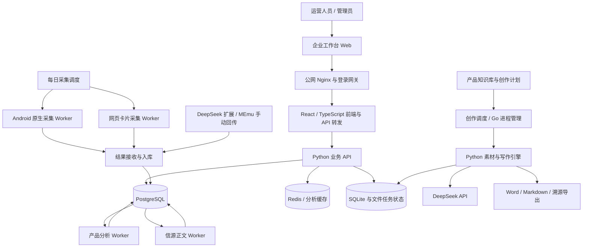

# 企业工作台

企业工作台面向品牌运营团队，集成 **GEO 多平台监测、二级词监控、内容创作、抖音视频台账、员工绩效和素材管理**。

系统支持服务器定时采集，也支持用户在 DeepSeek 网页或逍遥模拟器中提问后，手动回传当前会话。采集结果进入统一数据层，再供监测看板、内容素材和绩效计算使用。

本文按截至 **2026-11-11** 的代码与已部署组件整理。当前通道状态、计划和完成进度以线上页面为准。

- 线上工作台：https://ifbcy.com/geo_monitor/
- 源码仓库：https://github.com/about-felicity/enterprise-workbench-20261029
- 默认业务时区：`Asia/Shanghai`

## 目录

- [系统能力](#系统能力)
- [技术架构](#技术架构)
- [数据流与任务执行](#数据流与任务执行)
- [代码目录](#代码目录)
- [日常使用](#日常使用)
- [统计与绩效口径](#统计与绩效口径)
- [部署与开发](#部署与开发)
- [运维与故障处理](#运维与故障处理)
- [源码更新与恢复](#源码更新与恢复)

## 系统能力

| 模块 | 主要功能 | 使用入口 |
| --- | --- | --- |
| GEO 监测 | 多模型回答采集、原问题保存、正文与引用归档、每日产品表现 | 模型总览、问题对比 |
| 信源分析 | 信源链接、媒体归属、正文抓取、自有品牌和产品命中分析 | 信源洞察、品牌与产品 |
| 二级词 | 按产品和月份维护问题，查看每日采集、分析状态和月度表现 | 二级词监控 |
| 内容创作 | 产品知识库、采集计划、素材筛选、语义骨架、生成、按策略审核和导出 | 内容创作中心 |
| 抖音视频数据 | 独立台账、状态核查、互动指标、采集历史和每日失效率 | 达人视频数据、付费媒体视频数据、自有员工视频数据 |
| 素材库 | 浏览素材目录、预览图片和打开原图 | 素材库 |
| 员工绩效 | 产品归属、流量目标、预算、提及率达成、月度权重、确认记录 | 绩效考核 |
| 采集控制 | 通道状态、登录、批次、频率、进度、暂停与恢复 | 采集控制 |
| 回答审计 | 查询原始回答、来源、分析状态与证据 | 回答审计 |
| 资产管理 | 资产、设备等内部管理功能，独立后端与页面 | 资产管理入口 |
| DeepSeek 手动回传 | Chrome 扩展、逍遥模拟器置顶按钮、本地队列与入库回执 | 同事端采集工具 |

### 相关子项目

- `资产管理/` 使用 FastAPI、SQLAlchemy、SQLite 与独立前端，提供内部资产管理。其依赖和运行入口与 GEO 服务分别维护。
- `ecommerce-review-exporter/` 是 Chrome / Edge Manifest V3 扩展，采集淘宝、天猫、京东评论，支持去重、草稿恢复与 XLSX 导出。
- `writing-agent/` 保存独立写作 Agent 项目，包含桌面、CLI 与原有插件工作流，按该子项目文档使用。
- `multi-agent-content-studio/` 保存多 Agent 内容创作子项目，具体配置与人工审批流程见其 README。
- `Scrapling/`、`redroid/` 等目录包含采集或 Android 运行相关上游源码，依赖许可和使用方式以对应子项目为准。

### 采集通道

| 平台 | 实现方式 | 运行特点 |
| --- | --- | --- |
| 豆包 | Android 原生 App、ADB / UI 自动化、原生会话数据读取 | 多账号实例独立批次，发送前校验新会话与原题 |
| 腾讯元宝 | Android 原生 App、界面操作与原生数据适配 | 保留原始请求和回查证据，待确认请求可与其他题目的续采分开处理 |
| 百度 AI 卡片 | 浏览器自动化 | 区分有回答、无 AI 卡片、采集失败和平台验证 |
| 文心卡片 | 浏览器自动化 | 主 GEO 调度中与百度串行衔接，支持持久化退避 |
| DeepSeek 网页 | 用户提问、Chrome 扩展提取、本地接收器回传 | 用户等待回答完成后主动回传 |
| DeepSeek 逍遥版 | Windows 工具、MEmu ADB、UI 校验和本地 SQLite 快照 | 提取当前会话最新问答及完整信源 |
| DeepSeek 原生自动通道 | 独立原生采集代码与登录检测 | 当前停用 |

通道需要对应账号和可用环境。主 GEO 与创作素材采集各自维护任务与计划，执行时间由配置决定。

## 技术架构



### 技术栈与职责

| 层级 | 技术与组件 | 职责 |
| --- | --- | --- |
| 业务前端 | React、TypeScript，沿用现有 Vinext / Vite 构建环境 | 看板、筛选、计划配置、二级词、绩效和录入交互 |
| 公网入口 | Nginx、Python 登录网关、签名会话 | 登录校验、路径转发、短时身份签名和写请求校验 |
| 业务后端 | Python 3.10+、HTTP API、`monitor_core` | 查询、入库、分析、统计、权限与绩效计算 |
| 原生采集 | Android / redroid、ADB、uiautomator2、平台专用适配器 | 界面准备、单次发送、原始消息绑定和完整性校验 |
| 网页采集 | 浏览器自动化、Playwright 运行环境、平台卡片采集器 | 回答、搜索来源和平台状态识别 |
| 正文读取 | Scrapling、多后端读取、独立进程超时 | 网页正文准备、缓存复用、失败分类 |
| 写作编排 | Python 创作引擎、Go dispatcher 与模型传输 | 任务分发、并发控制、素材阶段、模型调用与恢复 |
| 模型服务 | DeepSeek API | 产品分析、骨架提取与复核、文章生成及按策略审核 |
| 主数据存储 | PostgreSQL | 回答、信源、产品结果、原始接收事件、月度问题配置 |
| 运行状态 | SQLite、JSON / JSONL、目录队列 | 通道任务、发送证据、创作进度、费用与手工录入审计 |
| 服务管理 | Docker、systemd、timer | 长驻服务、每日调度、进程监督和组件独立更新 |

Go 层负责进程、调度和模型传输等执行工作。Python 层保留素材筛选、业务规则、写作流程和结果校验。

### 主要运行组件

以下是当前部署采用的组件名称，供运维定位使用。

| 组件 | 服务或容器 | 主要职责 |
| --- | --- | --- |
| Web 前端 | `monitor-dashboard` | 企业工作台页面与同源转发 |
| 主 API | `monitor-dashboard-api` | 监测、统计、绩效与配置接口 |
| 数据库 | `monitor-postgres` | PostgreSQL 业务数据 |
| 缓存 | `monitor-redis` | 缓存组件，具体用途见各模块配置 |
| 产品分析 | `monitor-product-worker` | 待分析回答的产品识别与校验 |
| 信源正文 | `monitor-content-worker` | 来源正文抓取、自有产品命中分析 |
| 结果接收 | `monitor-result-receiver` | 外部采集结果接收与处理 |
| 每日控制器 | `geo-daily-control` | 配置协调、批次接续、登录及异常状态处理 |
| 原生批次 | `geo-native@<batch>` | 单个 Android 采集批次 |
| 网页批次 | `geo-web@<batch>` | 单个网页采集批次 |
| 抖音视频台账 | `geo-creator-videos`、`geo-paid-media-videos`、`geo-employee-videos` | 三个独立台账和共享浏览器并发 |
| 创作 API | `geo-content-api` | 知识库、计划、任务与导出接口 |
| 创作调度 | `geo-creation-studio`、`geo-content-worker` | 计划生成与写作任务执行 |

## 数据流与任务执行

### 1. GEO 自动采集

1. 每日控制器根据日期、问题、轮数、通道和配置版本建立批次。
2. Worker 读取持久化任务。Android 采集在发送前检查账号页面、新会话、原题及发送按钮。
3. 点击发送前保存发送意图，之后读取与该任务绑定的原始消息和回答。
4. 完整回答与信源经过校验后进入待回传队列。
5. 接收端处理并返回回执，Worker 根据回执更新本地交付状态。
6. 产品分析和正文抓取由各自 Worker 后续执行，看板按实际处理状态展示结果。

采集、回传、产品分析和来源正文准备分别维护状态。界面中的“待分析”“未采集”“平台验证”“无正文回答”各有对应证据和处理路径。

豆包和元宝的原始发送结果待确认时，调度在批次排空并核对隔离证据后保存待查请求，再续采其他题目。已确认的纯卡片或视频回复单独记录，在采集进度中计入不可用轮次。

### 2. DeepSeek 手动回传

```text
用户手动提问 → 等待回答结束 → 点击回传
→ 提取当前最新问答与信源 → 本地持久队列
→ 公网接收端 → 入库处理 → 回执 → 展示已入库
```

逍遥版通过 UI 确认当前会话、最新回答末尾和来源数量，再读取对应本地数据库快照，核对会话与消息身份。工具需要具备读取 App 会话数据的 ADB 权限，适配范围取决于模拟器和 App 版本。

客户端保存待发送队列，收到工作台处理回执后展示成功。设备登记和上传凭据需要按实际部署单独配置。

### 3. 内容创作

```text
上传产品知识库 → 确认资料版本 → 配置计划
→ 按问题采集 → 获取完整正文 → 媒体与话题筛选
→ 语义骨架提取 / 复核 → 文章生成
→ 按任务策略审核或返修 → 成稿与溯源导出
```

- 计划包含产品、问题、采集通道、执行时间、频率、篇数及预算。
- 执行时保存产品资料与计划快照，后续资料更新通过新版本进入后续任务。
- 素材不足时记录缺口并按补采策略继续，补采受次数上限和平台状态约束。
- 外部正文读取使用独立进程设置整体超时，避免单条重定向或浏览器读取长期占住任务。
- 支持完整原文、已确认骨架、产品资料、预算与模型参数的绑定。
- 审稿、修订轮数和下载条件由对应任务策略决定，具体结果见任务证据。
- 导出支持 Word、Markdown，以及原文链接、来源信息和过程证据。

### 4. 持久化与恢复

| 场景 | 处理方式 |
| --- | --- |
| 发送前页面未稳定 | 有界等待，未满足校验则退避 |
| 已点击但请求编号未知 | 保存发送证据，回查原始会话，超时隔离 |
| 单条回答长期不完整 | 保留原请求身份，允许独立后续题目继续 |
| 隔离任务收尾 | 有界回查后进入冷却，再由控制器安排后续检查 |
| 网络中断 | 保留待交付记录、回执和请求状态，按错误类型退避 |
| 平台验证或登录失效 | 转为验证等待或登录等待 |
| 非正文 / 小程序回答 | 单独记录可用性，正文统计使用相应有效样本规则 |
| 付费调用结果未知 | 保留调用目录、请求指纹及费用预留，进入核对流程 |
| 稿件或输入发生变化 | 校验输入身份和已有请求参数，按策略生成新版本 |

## 代码目录

| 目录 | 主要内容 |
| --- | --- |
| `geo-monitor-deploy/dashboard-integration/app/` | 工作台前端与 API 路由 |
| `geo-monitor-deploy/creator-videos/` | 三套抖音台账共用的采集器、调度、接口和 systemd 单元 |
| `geo-monitor-deploy/server-source/` | 主后端、结果处理和分析 Worker |
| `geo-monitor-deploy/server-source/monitor_core/` | 数据库、统计、产品规则、绩效、二级词、身份验证 |
| `geo-monitor-deploy/creation/` | 创作计划、知识库、素材、补采、恢复、导出 |
| `geo-monitor-deploy/creation-go/` | Go 创作执行与模型传输组件 |
| `geo-source-card-collectors/geo_source_cards/` | 网页采集与写作引擎 |
| `geo-source-card-collectors/geo_source_cards/rewrite_v2/` | 语义骨架、素材处理、全文生成和审核相关代码 |
| `redroid-deploy/` | 豆包 Android 采集、发送校验、隔离与回查 |
| `yuanbao-deploy/` | 元宝原生数据读取与恢复 |
| `DeepSeekCollector/app/`、`extension/` | Windows 本地接收器、逍遥按钮和 Chrome 扩展 |
| `deepseek-browser-deploy/` | DeepSeek 浏览器通道、公网回传与部署历史 |
| `deepseek-deploy/` | DeepSeek 原生自动通道 |
| `source-snapshot/` | 带来源和哈希清单的历史源码基线 |
| `maintenance/` | 分日期维护、验证与迁移记录 |
| `writing-agent/`、`multi-agent-content-studio/` | 其他写作相关子项目，使用各自入口和说明 |
| `资产管理/` | FastAPI 资产管理后端与前端 |
| `ecommerce-review-exporter/` | 淘宝、天猫、京东评论采集和表格导出扩展 |

优先查看当前模块代码与其调用关系。带日期的报告、快照和维护脚本用于查证对应阶段的实现。

## 日常使用

### 第一次进入工作台

1. 打开工作台并使用已分配的账号登录。
2. 进入采集控制，确认目标通道的登录状态、问题列表、轮数和计划时间。
3. 在模型总览或问题对比中选择日期、问题与模型，查看回答数、产品表现和采集详情。
4. 对异常数据打开原始回答、分析状态及信源详情核对。

账号权限由登录网关与后端共同校验。`superadmin` 提供绩效数据录入权限，`geo_admin` 与 `superadmin` 可按当前规则编辑月度二级词。

### 配置产品与二级词

1. 在产品目录中确认产品正式名称、品牌、别名和对应的监控问题。
2. 打开“产品月度二级词”，选择月份、产品和模型。
3. 新增具体问题，例如“推荐一款适合在家染的染发剂”。
4. 按需编辑、暂停或恢复。问题变更保存版本及有效时间窗口。
5. 对照回传的原始问题查看该词的有效样本、提及与推荐情况。

二级词编辑负责问题配置和统计范围。自动采集计划、写作计划或手动回传仍需使用对应问题执行，具体联动以该入口的代码与配置为准。

### 使用逍遥模拟器回传

1. 准备已授权配置的客户端目录，确认 MEmu 可通过本机 ADB 连接。
2. 启动 DeepSeek App 并登录，在 App 中手动提问。
3. 在 Windows 进入 `DeepSeekCollector` 目录，运行 `python -X utf8 app/memu_button.py`，显示置顶的回传按钮。
4. 等回答结束，滚到最新回答末尾，显示来源数量，关闭已展开的搜索结果面板。
5. 点击“回传当前会话”，查看队列和入库回执。

多设备时可通过 `MEMU_ADB`、`MEMU_SERIAL` 指定路径和设备。Python 环境需要 Tkinter。Chrome 方案的操作见 `DeepSeekCollector/使用说明.txt`。

### 创建写作计划

1. 在产品知识库中上传资料，检查提取结果、名称、品牌和产品图片。
2. 确认资料版本后创建任务，设置问题、通道、时间、频率、篇数与预算。
3. 在任务详情中查看采集、正文准备、补采、生成及审核阶段。
4. 处理平台登录、验证或素材缺口后，从任务支持的恢复入口继续。
5. 在成稿区下载单篇文章、Word 或筛选结果，按提示选择是否保留文末参考链接。创作阶段保存参考资料的标题和完整网址，可引用与主题相关的成分解析、功效科普等资料。

### 使用抖音视频台账

1. 在左侧打开对应台账，粘贴抖音分享文案或作品链接。每批最多 50 条，系统按北京时间记录录入日期。
2. 达人和付费媒体台账支持录入及修改应付费用，自有员工台账记录登录账号对应的上传人。
3. 按录入日期、数据日期、账号或作品状态筛选，查看发布时间、点赞、评论、收藏、转发和采集历史。单条作品可手动刷新，删除权限由超级管理员持有。
4. 在“每日失效率”切换录入日期或核查日期。失效率使用确认不可用作品数除以已确认作品数，待确认和缺少链接分别列示。

作品按 15 分钟到期复查，已确认不可用的作品也会继续核查。三套台账共享最多 6 个浏览器名额，各保留 1 个名额。单条读取失败按 5、10、15 分钟退避，保留最近一次确认状态。抖音返回限流时，共用平台冷却时间。

### 使用绩效考核

1. 选择考核月份和截止日期。
2. 超级管理员通过“录入数据”填写每日流量、累计费用、日目标和月预算。
3. 打开员工卡片，查看分项得分、产品明细、模型权重与数据覆盖情况。
4. 到月末按确认窗口执行个人确认，系统保存所确认成绩的快照与指纹。

员工、产品归属和权重按月份配置。11 月配置使用流量 55%、预算 15%、提及达成率 20%、价值观 10%，历史月份加载各自配置。配置与计算分别见 `performance_data_202611.json`、`performance_store.py` 和 `employee_assessment.py`。

## 统计与绩效口径

### GEO 指标

- **正文提及率**：在有效、已分析回答中，正文明确提及目标产品的回答数 ÷ 对应有效回答数。
- **推荐率**：按对应看板的已验证推荐规则，目标产品被明确推荐的回答数 ÷ 有效回答数。
- **首推率**：按模块要求识别明确首推证据，月度二级词模块要求首推标记与推荐证据对应。
- **有效样本**：符合该视图完整性、分析状态、原问题和日期范围要求的回答。
- **待分析样本**：已接收但尚未满足产品分析条件的记录，单独显示。

每次模型回答形成一次观察。多次采样的提及比例是该批样本下的表现；跨模型、跨日期比较时需要同时查看样本量与有效日期。

日监控看板与月度二级词模块使用各自的聚合入口。日监控口径参考 `analytics.py`，二级词按原问题规范化匹配、有效版本窗口及已完成分析的回答统计，见 `monthly_keywords.py`。

### 绩效公式

```text
流量得分 = 有效日期累计搜索数 /（日目标合计 × 有效日期数）× 100%
预算得分 = 截至费用节点的计划预算 / 节点累计花费 × 100%
提及达成率 = 实际提及率 / 目标提及率 × 100%
综合绩效 = 各分项得分 × 对应月份分项权重，再求和
```

- 预算得分按配置限制在 80%～150%。
- 提及单项达成率最高 200%，再按产品与模型权重聚合。
- 缺失的流量日期、费用节点和模型样本通过覆盖状态体现，影响参考成绩完整性。
- 手工流量、费用与目标录入带版本号、操作编号和审计记录。
- 原始采集数据、产品分析证据和手工录入分开保存，便于追溯。

## 部署与开发

### 环境准备

| 环境 | 需要准备 |
| --- | --- |
| Linux 服务端 | Docker、systemd、Python 3.10+、PostgreSQL、Redis、网络与 DNS |
| 前端 | 对应基础镜像的 Node.js 环境、依赖清单及锁文件 |
| 原生采集 | Android / redroid 实例、ADB、匹配版本 App、登录状态和数据读取能力 |
| 网页采集 | 对应 Python 环境、浏览器运行时、登录或验证处理能力 |
| 模型调用 | 可用 DeepSeek API 凭据、预算配置与调用账本 |
| Windows 回传 | Python / Tkinter、Chrome 扩展或 MEmu、设备登记及回传配置 |

### 现有服务路径

| 路径 | 内容 |
| --- | --- |
| `/opt/monitor` | 主业务 API 与分析模块 |
| `/opt/monitor/geo-capture` | GEO 控制器与网页批次 |
| `/opt/monitor/geo-content` | 创作 API、编排和部署后的引擎 |
| `/opt/monitor/geo-creator-videos` | 抖音视频核查服务代码 |
| `/var/lib/geo-creator-videos`、`/var/lib/geo-paid-media-videos`、`/var/lib/geo-employee-videos` | 三套独立的 SQLite 台账 |
| `/var/lib/geo-video-checks` | 共享浏览器名额和平台冷却状态 |
| `/home/user/redroid-doubao` | 豆包实例、批次与原生采集代码 |
| `/home/user/redroid-yuanbao` | 元宝实例、批次与原生采集代码 |

以上路径反映当前部署约定。新机器应按实际目录与配置调整。

### 本地开发入口

网页采集与写作包可在独立 Python 环境中安装并查看命令帮助。

```bash
python -m venv .venv
# 激活当前平台的虚拟环境后执行
python -m pip install -e "./geo-source-card-collectors[writing,bridge]"
geo-source-cards --help
geo-daily-editorial --help
```

浏览器、App、数据库连接和模型凭据需继续按模块配置。可先运行相关模块的隔离测试，再接入实际平台。

```bash
python -m unittest discover -s redroid-deploy/tests -p "test_native_zero_sources.py"
cd geo-monitor-deploy/creation-go
go test ./...
```

测试需要对应模块依赖。实际网页与 Android 采集还需要完整运行环境，已有测试中的平台集成部分可能使用专用路径。

### 前端构建

`geo-monitor-deploy/dashboard-integration/Dockerfile` 基于现有 `monitor-dashboard:local` 镜像，复制 app 与测试并执行 `npm run build`。首次部署需要先准备与项目匹配的基础镜像及依赖环境，再构建集成层。

```bash
docker build -t monitor-dashboard:reviewed ./geo-monitor-deploy/dashboard-integration
```

各模块的生产参数通过部署配置、环境变量和受控凭据文件注入。数据库连接使用 `MONITOR_DATABASE_URL`，模型与客户端参数以各自模块说明为准。源码导出中的 `REDACTED_CONFIGURE_LOCALLY` 需要配置为环境对应的值。

### 部署顺序

1. 准备数据库、缓存、数据卷、网络和 DNS。
2. 配置主 API、结果接收器、产品分析和信源正文 Worker。
3. 配置公网网关、登录会话与转发规则，验证页面和 API 访问。
4. 建立 Android 和网页采集通道，逐个验证登录、原问题、回答和入库回执。
5. 配置创作知识库、预算、模型通道与调度服务，先用一个受控任务验收。
6. 核对绩效月份、员工和产品配置，再开放日常录入。
7. 按计划启用定时任务，并观察实际跨日运行。

具体服务参数参考各模块的 `systemd/`、部署说明和当前运行配置。维护目录中的历史脚本需先核对适用条件。

## 运维与故障处理

### 基本检查

在当前 Linux 部署主机执行以下只读检查。

```bash
docker ps --format 'table {{.Names}}\t{{.Status}}'
systemctl is-active geo-daily-control geo-content-api geo-content-worker geo-creation-studio
journalctl -u geo-daily-control -n 50 --no-pager
curl -fsS http://127.0.0.1:8803/api/panel
curl -fsS http://127.0.0.1:8804/api/status
for port in 8812 8813 8814; do curl -fsS "http://127.0.0.1:$port/health"; printf '\n'; done
```

面板按通道看当日批次、入库增长、最后活动时间、当前阶段与下一次重试时间。原生批次日志可通过 `journalctl -u geo-native@<batch>` 查看，网页批次使用 `geo-web@<batch>`。

视频核查端口 8812、8813、8814 依次对应达人、自有员工、付费媒体。健康接口显示近 15 分钟核查数、到期队列、最长超期、核查耗时和冷却状态。链接增多时，按这些数据判断并发余量。

### 常见问题

| 表现 | 核对内容 | 处理方向 |
| --- | --- | --- |
| 多个素材域名同时解析失败 | 系统 resolver、NetworkManager 上游 DNS、实际域名解析 | 恢复当前网络 DNS，再继续原素材准备任务 |
| 新会话或键盘布局反复退避 | App 版本、控件、新会话身份、键盘稳定状态 | 检查发送前校验和等待期限 |
| 原题长期等待请求编号 | 点击意图、请求绑定、原生消息与隔离标记 | 沿原始证据回查，检查隔离和冷却状态 |
| 采集完成但未入库 | outbox、接收端、回执、校验错误 | 根据交付状态恢复 |
| 已入库但看板待分析 | 产品分析队列、模型可用性、结构化证据 | 核对对应分析 Worker |
| 平台验证 / 等待登录 | 当前平台页面、登录状态、恢复记录 | 完成所需验证或登录，再核对服务状态 |
| 正文源不足 | 媒体范围、话题、正文长度、补采次数 | 修复读取原因或补充合格来源 |
| 绩效页面月份报错 | 实际请求的 `YYYY-MM`、前端版本、北京时间日期 | 核对日期生成和月份配置 |
| 回传按钮报错 | ADB、设备选择、App 版本、回答是否结束、本地诊断日志 | 根据客户端反馈定位并重试 |

### 凭据、权限与数据

- 服务器凭据、数据库密码、API Key、浏览器登录态和客户端登记信息由部署环境管理。
- 公网写请求使用会话身份、来源和 CSRF 校验，绩效确认另有个人密码与成绩快照。
- 主业务表包括 `monitor_ingest_events`、`monitor_runs`、`monitor_sources`、`monitor_products`。
- 月度二级词配置保存在 `geo_monthly_keywords`，手工绩效录入使用独立 SQLite 存储。
- 创作运行目录、计划、原始资料、成稿与费用账本需要纳入独立备份策略。
- API 费用账本区分预留与已结算记录，金额以配置费率估算并结合服务商账单核对。

## 源码更新与恢复

本仓库保存经过筛选、脱敏的项目源码及历史快照。源码、基础镜像、运行依赖、账号和业务数据共同构成实际部署环境。

日常更新按以下流程执行。

1. 确认需要修改的当前模块及调用方。
2. 核对线上版本，备份目标源码和必要配置。
3. 完成与变更相关的验证，保留已有任务、请求指纹与账本证据。
4. 定点部署，观察真实入口和后续入库或成稿。
5. 将对应源码与测试提交到 GitHub，核对远端提交编号。

仓库中的 `source-snapshot/` 和技术版本记录可用于追踪旧阶段实现。恢复时先核对文件来源、manifest、SHA 和服务版本，再选择对应组件执行。

更新 README、运行记录或 Git 提交后，生产页面是否已更新仍需通过实际部署与入口验证确认。
