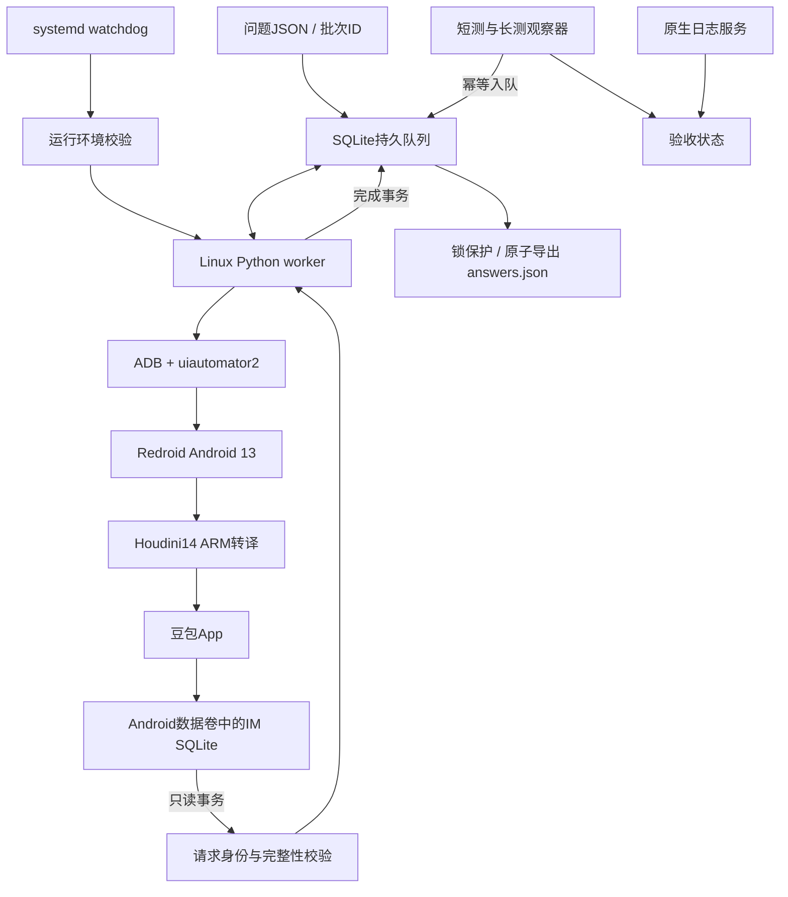
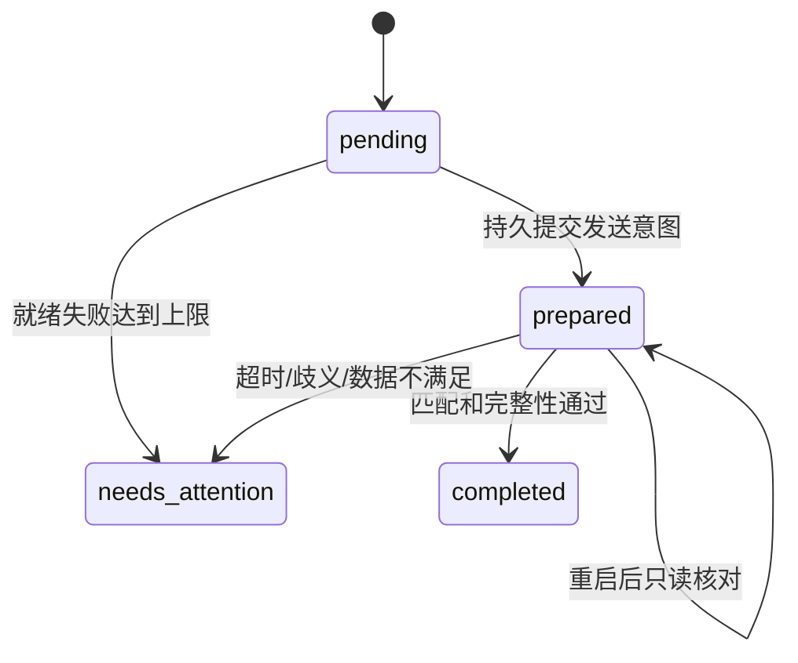

# 豆包无头 Android 采集系统详细技术说明

核查日期：2026-10-12。依据现有Python源码、Compose、systemd配置以及服务器状态文件和汇总报告。本文不把历史方案当作当前方案，也不把文件完整性检查当成答案事实审核。

## 1. 系统职责与边界

输入是一组UTF-8问题字符串。系统负责持久化排队，在豆包App新会话中发送问题，等待回答完成，将完整正文、信源及正文引用连同请求身份导出为JSON。

“无头”指Linux上持续运行Android和worker，不要求Windows桌面、scrcpy、浏览器或SSH会话保持打开。Android内部仍有App界面；系统用UI自动化完成输入与发送，并非绕过App调用官方开放API。

不负责：信源网页全文抓取、媒体文章分类、仿写、Word排版、发布到媒体，也不自动解验证码、自动重新登录或判定回答事实真伪。

## 2. 总体架构



### 2.1 运行组件

| 组件 | 当前配置／职责 |
|---|---|
| Linux项目目录 | `/home/user/redroid-doubao`，以下示例沿用此路径 |
| Android容器 | `doubao-hpe14-13-test`，名称沿用实验时期，不代表仍是临时环境 |
| 镜像 | `doubao/redroid:13-hpe14-com1.3` |
| Android | 13，SDK 33 |
| 转译组件 | Houdini `14.0.0_z.GoogleGame_com1.3` |
| App | 包名`com.larus.nova`，15.2.0，versionCode `15020040` |
| 数据卷 | `doubao-hpe14-android13-data`，外部卷 |
| ADB映射 | 主机`127.0.0.1:5557` → 容器5555 |
| App控制 | `uiautomator2==3.7.0`、ADB `input tap` |
| Python依赖清单 | 另含`paramiko==5.0.0`供部署连接使用 |
| Android资源 | CPU 2核限额，内存3GB |
| Worker资源 | CPUQuota 100%，MemoryMax 512MB |

Compose使用`privileged: true`，并非强隔离安全沙箱。ADB仅绑定回环地址，远程维护使用SSH隧道；不要直接开放公网ADB。

### 2.2 源码职责

| 文件 | 职责 |
|---|---|
| `unattended_core.py` | SQLite队列、事件、请求／回答只读匹配、结果校验 |
| `unattended_worker.py` | App适配、发送阶段、超时、双锁、systemd通知、原子导出及CLI |
| `runtime_preflight.py` | 镜像、启动、SDK、转译库校验、APK版本与到期截止检查 |
| `compose.hpe14.yaml` | Android实例、端口、资源、外部数据卷和系统属性 |
| `soak_monitor.py` | 定时入队、健康检查、实际观测时长和阶段状态 |
| `soak_sequence.py` | 短测通过后才运行长测 |
| `hpe14_report.py` | 汇总任务、结果、原生错误、容器和业务容器状态 |
| `redroid-doubao-hpe14-worker.service` | 正式worker服务 |
| `redroid-doubao-native-log.service` | 原生错误持久日志 |
| `redroid-doubao-soak24h.service` | 短测→长测观察器服务 |
| `test_unattended.py` / `test_soak_sequence.py` | 历史离线恢复与验收门槛测试 |
| `backup_hpe14_release.py` / `backup_android13_volume.py` | 备份工具，运行前需核对脚本副作用 |

上述源码现已纳入redroid-deploy目录。运行仍需准备Linux环境、已验证镜像、依赖与登录数据；不能在Windows直接运行Linux worker。

## 3. 执行链路

1. CLI读取问题数组，使用批次名与题号建立稳定任务身份。
2. worker获取设备级锁和队列锁，检查是否已有待处理任务。
3. 读取App数据库，先查本任务是否已经发出或完成，再决定是否进入UI流程。
4. 检查App版本，启动Activity，进入新会话，找到输入控件。
5. 在事务中持久提交发送意图及协议版本。
6. 填写完整发送文本并回读校验；点击前单独持久提交点击意图。
7. 通过ADB点击发送，随后只读App数据库等待并核对答案。
8. 正文、完成状态、身份、信源与引用通过检查后，事务提交completed。
9. 导出已完成结果；失败时保留队列、事件、日志和尽力采集的截图／XML。

### 3.1 输入与任务编号

输入例子：

```json
["问题一", "问题二"]
```

任务ID为`uuid5(uuid.NAMESPACE_URL, batch + ':' + ordinal)`，序号从1开始。实际发送文本：

```text
原始问题

（采集任务编号：<task_id>；请仅回答上述问题。）
```

必须区分`question`和`wire_question`。当前实现会附加追踪标记，**不是完全逐字发送原问题**。如果未来业务要求原问题绝对不变，需要重新设计关联机制并验证，不能直接删标记而继续声称能够可靠恢复。

同批次、同序号、相同内容重复入队幂等；修改已有问题或require_sources会拒绝。内部观察器允许按同一批次逐步扩展前缀，已入队项不重复生成。

## 4. 队列与恢复协议

### 4.1 数据模型

`tasks`主要字段：

| 字段 | 含义 |
|---|---|
| task_id | 稳定主键 |
| batch / ordinal | 批次与题号，联合唯一 |
| question / wire_question | 原问题与实际发送文本，后者唯一 |
| require_sources | 是否必须提取到有效信源 |
| state | pending、prepared、completed、needs_attention |
| attempts / prepared_at | 准备失败次数、发送阶段时刻 |
| request_id / answer_id | App请求和答案身份 |
| result_json / error | 通过检查的结果或失败原因 |

`events`追加记录task_id、时间、事件名及细节。发送和点击意图写入事务，不只存在内存或文本日志里。SQLite使用WAL和`synchronous=FULL`。



### 4.2 两阶段发送意图

- `send_intent_committed`：已计划发送，不代表已经点击或服务端收到。
- `send_protocol_v2`：明确采用新发送阶段协议。
- `send_click_intent_committed`：已进入可能点击的边界，禁止自动二次点击。
- 新协议有发送意图、但无点击意图，且App中无对应请求时，才允许完成未发送的操作。
- 已有点击意图却没有找到请求时，保守等待／待处理，不猜测没有发出去。
- 旧记录缺少协议证据，不自动按新协议重发。

这不是端到端exactly-once承诺：本地SQLite事务和远端App接收无法合为一个原子事务。实现优先避免不确定状态下重复提问，代价是某些任务必须人工核对。

### 4.3 熔断

任意任务进入needs_attention后，worker返回退出码2。systemd配置`RestartPreventExitStatus=2`，所以服务显示failed可能是有意熔断，不应直接等同模拟器崩溃。

prepared任务优先恢复；不会跳过失败题不断继续产出。基础设施异常保留发送状态并抛出，由systemd有限重启；登录、验证码、限流和schema变化没有全自动解决承诺。

## 5. App操作与数据读取

### 5.1 UI适配

启动Activity为`com.larus.nova/com.larus.home.impl.alias.AliasActivity1`。核心控件使用`com.larus.nova:id/`下的资源ID：

- `larus_chat_top_left_create_new_cvs`：新会话；
- `input_text`、`action_input`：输入；
- `action_send`：发送。

输入框在动画期间短暂消失时，只对填入与回读做有限重试，发送点击不包含在该重试块中。回读不等于完整wire_question时禁止发送。

界面、资源ID、Activity或App数据库结构更新都可能破坏适配，版本检查失败应重新验证，不能删除检查强行运行。

### 5.2 只读读取

通过`docker inspect`定位`/data`宿主挂载，扫描`data/com.larus.nova/databases/im_database_*`，排除WAL／SHM／journal文件并检查SQLite文件头。打开方式为`mode=ro`，设置`query_only=on`并开启读取事务。

这依赖当前Redroid数据卷和权限模型，不适用于普通未开放数据访问权限的手机。只读解析不修改App历史；也不是对任意App版本通用的标准接口。

### 5.3 请求与回答绑定

要求`im_message`包含`local_message_id`、`conversation_id`、`local_index`、`user_type`、`content`、`fts_content`。

1. 请求只从`user_type=1`中按完整wire_question匹配。
2. 答案只从同conversation、请求之后、下一条用户消息之前、`user_type=2`中选择。
3. 存在多个候选文本答案时拒绝猜测；跨数据库出现重复请求也拒绝。
4. 消息块必须为非空JSON列表，所有块`is_finish is True`才算完成。
5. 目前仅支持text_block、search_query_result_block以及为空的pc_event_block；未知块或非空PC事件明确报错。

### 5.4 导出协议

```json
{
  "question": "原问题",
  "task_id": "示例任务ID",
  "wire_question": "原问题及任务标记",
  "request_id": "App请求ID",
  "answer_id": "App答案ID",
  "conversation_id": "会话ID",
  "status": "complete",
  "finished": true,
  "body_markdown": "完整回答正文",
  "sources": [{"index": 1, "title": "来源标题", "url": "https://example.com/article", "doc_id": "示例文档ID"}],
  "citations": [{"pos": 10, "title": "来源标题", "url": "https://example.com/article", "doc_id": "示例文档ID", "insert_text": "引用标记", "summary": "来源摘要"}],
  "search_queries": []
}
```

信源与引用从App结构化内容解析，不靠截图OCR猜测。要求标题非空、URL为HTTP(S)且有主机名；有doc_id的引用必须关联已提取信源。重复信源保留原编号，不在此处做网页去重或访问性验证。

`require_sources=true`是本地验收要求，不保证App一定联网或返回来源；没有来源会拦截。这正是当前长测失败的重要业务条件。

## 6. 持久化、并发和资源

- `/run/lock/redroid-doubao-<container>.lock`限制一个实例由一个worker控制。
- 状态目录`worker.lock`避免两个worker同时消费同一队列。
- `export.lock`串行化数据库读取与导出，避免旧快照覆盖较新结果。
- 导出写临时文件、flush、fsync、原子替换，并fsync父目录。
- 只有completed结果进入answers.json；截图失败不会撤销已验证结果。
- 进程使用Linux `fcntl`、SIGALRM和Unix socket，因此worker并非直接可运行于Windows的跨平台程序。

systemd：Type=notify、WatchdogSec=120、Restart=on-failure、RestartSec=20、半小时最多3次启动限制、TimeoutStartSec=180、UMask=0077。

主要默认期限：初始化45秒，就绪70秒，发送25秒，截图10秒，答案300秒，轮询5秒。首次新会话控件等待35秒，失败后force-stop并再次等待20秒；准备失败最多3次。看门狗在长阶段之间报心跳，不能把所有超时混成单一答案超时。

## 7. 运行环境锁定与兼容性经历

启动校验：

| 项 | 预期值 |
|---|---|
| 镜像ID | `sha256:18244ad4ab1c36047438bb9c524d8f8d6f848ee8d7537a98483a26c5dda7601f` |
| libhoudini.so SHA256 | `5ef64035ec89bca3d5e33b9f3b6556f98f6c11d11957387d403ae4a4d7cc40ec` |
| native bridge | `libhoudini.so` |
| SDK | 33 |
| App versionCode | 15020040 |
| 当前组件本地截止 | UTC 2028-06-01起拒绝启动，提前于旧资料记录的上游期限 |

镜像或库重新构建后哈希可能变化，必须重新验证兼容性再更新基线。预检查还会禁用Android蓝牙；这不是宿主机网络配置修改。

此前Android15／NDK转译路径出现`guest_params_arch.h:278: CHECK failed: 32080 <= 0`以及SIGABRT，定位到ARM64 JNI可变参数转译相关路径。尚无完整客体栈证明异常数字的产生原因，不应直接归因App内存损坏。

Android15配合新Houdini的实验又遇linker namespace／ART原生方法注册兼容问题，未成为正式环境。当前用Android13与新转译组件绕开已复现的兼容问题，未修改APK、删除断言或证明所有App路径均无缺陷。

旧上游提交、二进制有效期属于历史构建记录；本次未重新核实上游最新发布，也未将这些二进制上传GitHub。

## 8. 部署、备份与迁移

推荐迁移已验证镜像与完整数据卷，而非直接重跑含一次性容器名称的历史构建脚本。

目标机需要Docker、对应宿主内核能力、已验证Android镜像、ADB、Python虚拟环境、App及人工建立的登录状态。`compose.hpe14.yaml`使用外部卷，不能单独生成登录数据或Houdini组件。

部署顺序：核对目标路径与端口→准备依赖→加载镜像并核对ID→恢复外部卷→创建Android实例→人工确认App可用→配置状态目录→运行预检查→安装本项目systemd单元→单题冒烟→故障恢复验证→重新长测。

执行脚本前检查硬编码目录、数据卷与容器名，不覆盖其他实例。任何主机重启、网络改动或业务容器变动不属于常规部署步骤。

一致性备份：停止本项目worker，再停止本项目Android，备份Android卷和完整队列／事件／配置／代码／镜像，生成哈希清单，再启动并验证。SQLite在线备份应使用backup API或保留正确WAL一致性，不能只复制正在写入的主文件。

Android卷、App IM库和截图可能包含登录凭据、历史对话和个人信息，应按敏感运行数据存储。文档仓库不包含它们。

## 9. 验收设计及真实结果

短测：3600秒、180秒间隔、20题。长测：86400秒、同频率、480题。`soak_sequence.accepted()`同时核对status、duration、interval、planned、enqueued、实际时长和任务数；只跑满时间或只答满题目都不算通过。

观察器仅入队和读状态，不操作App。它使用单调时钟统计时长；主机boot_id变化、两次观察间隔超过120秒、worker异常／心跳过期、原生fatal/ANR、任务待处理均可失败。任务收尾有300秒宽限，但不会把短于目标的观察算通过。

2026-10-12实查：

| 层级 | 结果及含义 |
|---|---|
| 初始106题 | 已通过历史报告；仅证明该测试集 |
| 1小时短测 | passed，20/20，3605.15秒 |
| 24小时长测 | failed，76593.95秒；426入队、425完成、1 prepared（阶段最后快照） |
| 当前总队列 | 562 completed、1 needs_attention，和阶段快照采样时刻不同 |
| 待处理错误 | Required sources are missing |
| 长测直接错误 | Worker service is not active |
| 当前服务 | ActiveState=failed、NRestarts=0 |
| 容器 | OOMKilled=false、RestartCount=0 |
| 日志 | 汇总报告native_fault_lines为空 |
| 原业务容器 | 报告显示运行中，容器ID与基线一致 |

合理解释是：严格的来源要求触发数据质量熔断，worker停止，观察器判长测失败。不能据此认定Android崩溃，也不能因没有崩溃就改写长测为通过。阶段快照中prepared与当前needs_attention不矛盾，不能把二者合并成同一时刻统计。

历史文档记载30项Linux故障测试及4项阶段门槛测试通过。本次是文档编写与只读核查，**没有重新运行故障注入、长测或真实提问测试**。

## 10. 已知限制与后续优先级

1. 当前worker熔断，不能说系统正在持续接收并处理新任务。处理缺信源任务需人工核对，不能直接改pending重发。
2. 账号掉线／验证码／限流目前依赖明确失败和人工处理；没有全自动账号恢复。
3. App数据库和控件资源ID是版本相关私有实现，适配升级成本不可忽略。
4. 信源格式有效不等于网页可访问，正文完整不等于事实正确。
5. 任务标记会改变实际发送文本，可能影响模型回答；如用于严格对照实验，必须将其作为实验条件。
6. 镜像、转译库和APK基线锁定提升可审计性，但限制随意升级；到期前必须验证新环境。
7. 多实例扩展需独立容器、ADB端口、数据卷、账号及状态目录，不能仅启动更多worker。
8. 原生日志检查依赖保留窗口和匹配规则，不是完整崩溃证明系统。
9. 当前长测曾失败且未重跑，通过更换报告文件或补计时不能修复验收。

下一步应先审阅缺信源任务的原始App回答，决定保留失败、改变未来批次的来源要求，或另建经授权任务；随后重新做独立短测／长测。升级日志分类和完成状态展示时，要保留原始失败证据。
