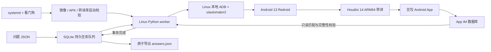

# ARM 转译崩溃修复与当前运行手册

更新：2026-10-07。本文是当前部署的操作入口。历史实验已归档到项目外，源码和运行目录清单见 PROJECT_TREE.md。

## 修复方案和证据边界

采用 **Android 13 Redroid + Houdini 14.0.0_z.GoogleGame_com1.3 + 官方豆包 15.2.0**。
原来会触发 CHECK 的 NDK 转译器已从当前执行链路替换。没有修改豆包 APK，也没有删除或跳过 CHECK。

首次六题完成后，重启模拟器，再启动 systemd 常驻 worker 执行额外 100 题测试。
**106 题已全部通过**：1,095 条信源记录、300 处正文引用、106 个唯一请求编号，未记录 App 原生崩溃、ANR、OOM 或自动重启。
发送过程中重启 worker 后，该任务正常恢复完成，没有重复发送。106 题定版报告见 `test-results/hpe14-acceptance.json`；最新累计快照见 `test-results/hpe14-current-status.json`，运行中的实时状态在服务器 `hpe14-acceptance/health.json`。
完成一致性备份并重启模拟器后，另两题冒烟测试通过，累计 108 题。随后隔夜运行约 13.5 小时，没有记录原生崩溃或自动重启；该阶段主要为空闲观察，不能代替持续提问验收。
最初每 10 分钟一题的长测在用户要求提高频率后停止并归档，不能计为通过。北京时间 **2026-10-07 10:20:22** 改为先运行 1 小时短测、每 3 分钟一题，共 20 题；短测全部通过且观察满 1 小时后，自动启动同频率的 24 小时长测，共 480 题。任一阶段失败就停止验收链路，保留证据。验证独立运行于服务器，关闭本地电脑或 SSH 不会停止它。
100 题批次已完成；24 小时验证是否完成以独立记录为准，不能把尚未完成的长测写成通过。

本次修复解决已复现的组件兼容问题。账号登录过期、验证码、服务限流、App 更新和网络故障仍可能需要处理；系统优先保留任务和明确失败，避免输出错配或半截数据。采集完整性校验不等于对豆包回答做事实审核。

## 故障定位

Android 15 上日志为：

```text
guest_params_arch.h:278: CHECK failed: 32080 <= 0
Fatal signal 6 (SIGABRT) ... DefaultDispatch ... com.larus.nova
```

AOSP 源码中第 278 行位于 `GuestVaListToSimdOffset`，检查 ARM64 `va_list.__vr_offs <= 0`。
Android 13 NDK 的此前日志涉及 `GuestVAListParams` / JNI `CallBooleanMethodV`。
因此触发点是 JNI 可变参数转换，与内存不足或 SSH 投屏无关。**尚未取得完整客体调用栈证明 32080 的产生位置**，不能仅凭这个数字断定豆包内存损坏。ARM 的 ABI 文档也允许寄存器区耗尽后使用非负偏移；这里能确定的是输入与当前转译器的假设不兼容。

调查上游发现旧 Houdini 存在日期到期问题。最新上游分支换成从 Google Play Games Android 14 提取的 com1.3 版本，相关项目已合并有效期延长到 2028-07-01 的更新。
这为换用新组件提供依据，但没有单独证明旧 ChromeOS 13 启动卡死一定由到期引起。

先用 Android 15 登录卷的副本测试新组件：发现 `libtcb.so` 的 linker namespace 限制；调整测试副本后，仍发生 `KevaImpl.loadRepo` 的 ART 原生方法注册失败。
该组合已停用。随后在 Android 13 上整合完整 HPE 转译库，实测聊天、正文和信源采集正常。

## 当前架构



Windows、浏览器和 scrcpy 均不参与后台执行。关闭本机窗口或断开 SSH，不会停止 Linux 服务。
原来的八个业务容器保持运行；只停止了本项目不再使用的模拟器实验容器。

| 项目 | 当前值 |
| --- | --- |
| Linux 目录 | `/home/user/redroid-doubao` |
| 容器 | `doubao-hpe14-13-test`（沿用测试时名称） |
| 镜像标签 | `doubao/redroid:13-hpe14-com1.3` |
| 已验镜像 ID | `sha256:18244ad4ab1c36047438bb9c524d8f8d6f848ee8d7537a98483a26c5dda7601f` |
| Android 数据卷 | `doubao-hpe14-android13-data` |
| ADB | Linux `127.0.0.1:5557`；Windows 投屏隧道 `127.0.0.1:15557` |
| worker 服务 | `redroid-doubao-hpe14-worker.service` |
| 任务和结果目录 | `/home/user/redroid-doubao/hpe14-acceptance` |
| CPU / 内存 | Android 2 核 / 3GB；worker 1 核 / 512MB |
| 豆包版本 | 15.2.0，versionCode `15020040` |

## 日常操作

下列命令在 Linux 执行。

查看状态和日志：

```bash
sudo systemctl status redroid-doubao-hpe14-worker.service --no-pager
sudo journalctl -u redroid-doubao-hpe14-worker.service -n 50 --no-pager
sudo cat /home/user/redroid-doubao/hpe14-acceptance/health.json
sudo python3 /home/user/redroid-doubao/hpe14_report.py
```

提交新问题：准备 UTF-8 JSON 字符串数组，例如 `["问题一", "问题二"]`。

```bash
sudo /home/user/redroid-doubao/worker-venv/bin/python \
  /home/user/redroid-doubao/unattended_worker.py enqueue \
  --batch my-batch-001 --questions /home/user/redroid-doubao/my-questions.json \
  --require-sources
```

新批次使用新名称。相同批次和相同问题再次入队保持幂等；不允许替换已存在批次的内容。
服务会顺序消费任务，无须手动执行 `run`。需要网页信源时使用 `--require-sources`，一般非联网题可省略。

结果是 `hpe14-acceptance/answers.json`。每条包括原问题、唯一任务编号、请求和回答 ID、完整 `body_markdown`、`sources`、`citations`、搜索词和完成状态。保留重复信源及其原始编号。
任务库是 `tasks.sqlite`，事件记录在 `events` 表；导出文件只含已完成且通过校验的任务。

暂停与恢复：

```bash
sudo systemctl stop redroid-doubao-hpe14-worker.service
sudo systemctl start redroid-doubao-hpe14-worker.service
```

暂停不清空队列。恢复后先查 App 数据库；新协议能证明尚未尝试点击的任务可以续行原发送操作。
已记录点击意图而结果不明时，绝不自动再次点击。旧协议记录缺少阶段证明，保守保留待核对。
如果出现 `needs_attention`，服务以退出码 2 停止：查任务错误和 App 状态，不能直接把任务改回 pending 来盲目重发。

Windows 临时投屏：

```powershell
.\redroid-deploy\open-doubao.ps1
```

默认打开新 Android 13 环境。`-Legacy` 指向历史 Android 15 环境，但该旧容器已停止。
后台运行时无需投屏。需要手动登录或排障时先暂停 worker，避免与自动操作争用界面。

## 针对已出现问题的优化

| 已出现或验证的问题 | 对应措施 |
| --- | --- |
| NDK JNI CHECK / SIGABRT | 换用 Android13 + 新 Houdini14，实际问题批次验证 |
| Android15 新 Houdini 的 namespace / ART 不兼容 | 保留诊断记录，停用该组合 |
| 模拟器重启后的冷启动慢 | 首次界面等待 35 秒，恢复操作总期限 70 秒，最多三次尝试 |
| UI 注入导致 Android15 InputDispatcher 崩溃 | 点击使用 ADB `input tap` |
| Bluetooth 无设备时反复崩溃 | 新环境关闭蓝牙；每次启动校验重申设置 |
| 两个队列争用同一模拟器 | `/run/lock` 的设备级锁，以及队列目录级锁 |
| worker 在发送边界中断 | 先持久写入发送意图，按唯一问题标记恢复，不自动重发 |
| 填入问题但点击前被中断 | 新协议分别持久记录发送与点击意图；只有明确未尝试点击才安全续行 |
| 长操作造成看门狗误判 | 分阶段上报心跳，操作有独立墙钟超时 |
| App 或转译库悄悄变化 | 启动检查镜像 ID、库 SHA256、Android SDK 和 APK versionCode |
| 未来转译库再次到期 | 2028-06-01 起启动检查拒绝旧版本，必须验证新版本后更新 |
| 回答半截、旧答案、错配来源 | 完成标记、角色、会话、请求编号、HTTP URL 和引用对应校验 |
| 导出过程中断电 | SQLite WAL/FULL，文件 fsync + 原子替换 |

新增原生诊断服务 `redroid-doubao-native-log.service` 持续把 Android fatal/ANR 相关日志写入
`hpe14-acceptance/native-runtime.log`，避免短期 logcat 缓冲区覆盖故障证据。
已有 22 项故障测试增加发送阶段、并发导出和输入控件切换恢复用例后，共 30 项 Linux 测试通过。
UI 输入控件短暂消失时只有限重试文本输入；点击发送不在重试块内。导出使用文件锁，避免 CLI 与 daemon 同时覆盖结果。

## 扩展与重新部署

`unattended_core.py` 独立承担任务、匹配和结果校验；增加输出格式优先从已完成的结果库导出。
新增 App 或更换 App 版本，先实现 UI 适配和数据库解析，再做完整性、重复提交、超时及重启回归。
多个模拟器使用不同容器、ADB 端口和数据卷，每个实例独立账号及状态目录；共享调度层只分配任务，不同时操作同一实例。

`compose.hpe14.yaml` 记录当前运行参数，使用现有外部卷，不负责创建登录状态。
定版镜像以 Docker save/load 迁移可保留镜像 ID。重新构建可能产生新的镜像 ID，必须在兼容性验收后更新 `runtime_preflight.py` 的 ID；不要删除检查来允许任意镜像运行。

新转译库来源固定为上游提交 `2f8f088671182e17e67321e098e8411a3972a628`。
下载归档 SHA256 为 `b945959d027128f98a4f1913b84337ab6b415852ed3b350570f38b71fbfb864d`。
64 位库 SHA256 为 `5ef64035ec89bca3d5e33b9f3b6556f98f6c11d11957387d403ae4a4d7cc40ec`。
旧 `build_hpe14_test.py` / `build_hpe14_13.py`、转译库下载包、APK 和构建目录已移入项目外归档。它们是包含一次性容器名称的实验记录，不应直接反复运行。镜像迁移优先使用定版备份。

备份前暂停 worker，再停止本项目 Android，完整备份该数据卷和 `hpe14-acceptance`，然后启动 Android 和 worker。
运行中的 SQLite 不应仅复制主文件而丢弃 WAL。恢复时保持容器/ADB/状态目录对应关系。
旧 Android 15 登录卷 `doubao-redroid_android15-data` 与旧 Android 13 卷仍保留，未清除账号数据。

本次定版备份目录为 `/home/user/redroid-doubao/backups/hpe14-20261006`：
镜像归档 `redroid13-hpe14-image.tar`、代码 `project-code.tar`、SQLite 一致性快照 `tasks-snapshot.sqlite`、完整 Android 登录数据 `android13-data.tar`。
校验和分别记在 `manifest.json` 与 `android-volume-manifest.json`。该目录限管理账号访问。

## 高频短测及长测

`redroid-doubao-soak24h.service` 运行 `soak_sequence.py`，先执行 1 小时/180 秒间隔的短测（20 题），通过后执行 24 小时/180 秒间隔的长测（480 题）。短测记录在 `soak1h/status.json`，阶段记录在 `soak1h/sequence.json`。短测未通过时不会启动长测；新增四项通过条件与失败阻断测试。
问题入队幂等；队列仍由同一个 worker 顺序消费，观察器不操作 App 界面。
主机重启、观察器超过 120 秒未检查、worker 健康状态异常或出现原生 fatal/ANR 时，明确记录失败。
仅到达 24 小时且所有计划题完成才记录 passed；任务结束后观察器退出，常驻 worker 继续等待新问题。

```bash
sudo cat /home/user/redroid-doubao/soak24h/status.json
sudo cat /home/user/redroid-doubao/soak1h/status.json
sudo cat /home/user/redroid-doubao/soak1h/sequence.json
sudo systemctl status redroid-doubao-soak24h.service --no-pager
```

`observed_seconds` 是实际单调时钟观测时长；`status=running` 不代表长测通过。

## 上游资料

- [AOSP ARM64 参数转换源码](https://android.googlesource.com/platform/frameworks/libs/binary_translation/+/refs/heads/main/guest_abi/arm64/include/berberis/guest_abi/guest_params_arch.h)
- [ARM AAPCS64 可变参数规范](https://github.com/ARM-software/abi-aa/blob/main/aapcs64/aapcs64.rst)
- [Houdini 新组件来源和版本](https://github.com/supremegamers/vendor_intel_proprietary_houdini/blob/hpe-14/README.md)
- [已合并的到期更新记录](https://github.com/casualsnek/waydroid_script/pull/286)
- [ERSTT Redroid 镜像说明](https://github.com/ERSTT/redroid)
