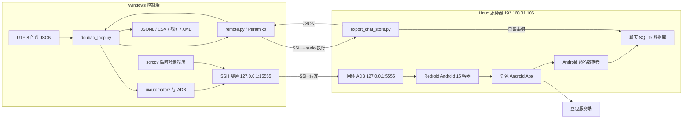
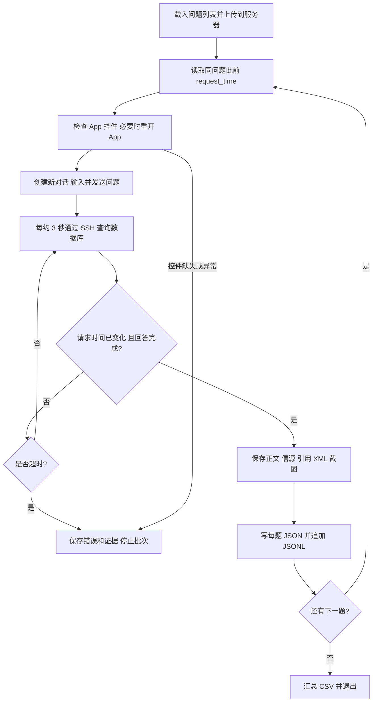

# 豆包无头 Android 项目：架构、操作与扩展手册

> **当前部署更新（2026-10-07，HPE14）**：当前执行环境已改为 Android13 + Houdini14 com1.3，常驻服务已启用，106 题及重启恢复已通过，30 项 Linux 故障测试通过；24 小时验收已启动。当前操作、故障修复和扩展入口见 [HPE14_FIX.md](HPE14_FIX.md)；本手册下方 Android15/NDK 状态与 Windows 循环命令属于此前实验记录。106 题报告见 `test-results/hpe14-acceptance.json`，最新累计快照见 `test-results/hpe14-current-status.json`。

历史版本：2026-10-06。以下保留旧环境的架构、解析细节和实验记录；涉及环境、稳定性和启动命令时，以 HPE14_FIX.md 为准。

历史补充（旧 NDK 环境）：当时新增 Linux 持久队列 worker 与看门狗，22 项故障测试通过，但 App 实机就绪失败，未启用常驻服务。此状态已由上述 HPE14 部署替代。下文 `doubao_loop.py` 是旧 Windows 实验链路。

## 1. 项目目标与当前结论

目标是在 Linux 服务器上后台运行 Android，在豆包 **Android App** 中登录、提交问题，然后直接从模拟器提取正文、搜索信源和正文引用，保存为结构化文件。

当前采用 Redroid 容器化 Android。这里的“无头”指 Android 持续在服务器后台运行，无须打开投屏窗口。登录时可临时用 scrcpy 操作；关闭窗口后，ADB 控制与数据库读取仍可进行。

本项目已验证数据可提取，但尚未解决豆包在 x86 ARM 转译环境中的稳定性问题。

| 能力 | 当前结果 | 实际边界 |
| --- | --- | --- |
| Android 15 启动、ADB 连接 | 已验证 | 运行在 Linux 服务器，本机 WSL 缺少 Binder |
| 官方豆包安装、账号登录 | 已验证 | 登录由用户在投屏窗口完成 |
| 后台提交问题 | 已验证 | 已提交 3 个测试问题并获得回答 |
| 提取完整正文 | 已验证 | 从聊天数据库读取原始 Markdown，不依赖 OCR |
| 提取信源原始 URL | 已验证 | 三题共 37 条记录，包含重复来源 |
| 提取正文引用 | 已验证 | 三题共 15 处，保留引用与文档信息 |
| UI 分享链接备用提取 | 部分可用 | PDF 等页面可能分享失败；重定向可能改变 URL |
| 自动循环脚本 | 实验性 | 代码已编写，最终稳定连续批次未通过 |
| 持久队列/Linux 本地 worker | 新增加固实现 | 22 项故障测试通过，真实 App 就绪失败 |
| 长期无人值守、多实例调度 | 未通过/未验证 | 不能据三题结果推断长期稳定性 |

最新测试结束后，后台 Redroid 容器保留，失败的豆包进程已停止，登录数据仍在命名卷中。原有 8 个业务容器未因本项目被停止或重启。

### 1.1 三题测试记录

| 问题 | 信源记录数 | 正文引用数 |
| --- | ---: | ---: |
| 中国国家博物馆地址与开放时间 | 12 | 4 |
| 故宫博物院预约入口 | 9 | 4 |
| Python 列表与元组区别 | 16 | 7 |
| 合计 | 37 | 15 |

这些是豆包 App 返回并落库的数据，测试没有独立核验回答内容，也没有保证每个来源 URL 都可以访问。

## 2. 技术架构



### 2.1 各层职责

1. **运行层**：Linux 内核与 Docker 启动 Redroid；Binder 支持 Android 进程间通信，命名卷保存 `/data`。
2. **兼容层**：宿主 CPU 是 x86_64，豆包 APK 的原生库是 ARM64，需要 `libndk_translation.so` 转译。
3. **控制层**：ADB 执行点击、启动/停止 App；uiautomator2 识别控件、输入文本、读取层级与截图。
4. **提取层**：服务器端 Python 通过 Docker 定位数据卷，以 SQLite 只读事务读取指定问题对应的消息。
5. **输出层**：控制端保存每题结果、JSONL、CSV，以及诊断 XML 和截图。

### 2.2 “无头”与进程所在位置

旧实验链路中 **Android 和数据库读取在 Linux 上；doubao_loop.py 在 Windows 上**。关闭 scrcpy 不影响后台 Android。新增 `unattended_worker.py` 已改为 Linux 本地控制，无须 Windows 或 SSH 隧道，但正式常驻服务没有启用，验收状态见 `UNATTENDED.md`。

原生 App 页面不是浏览器 DOM，本项目没有用 Playwright 抓取豆包网页版。App 内打开信源时可能使用 WebView，但默认数据提取不需要逐条访问信源页面。

### 2.3 控制链路与提取链路分开

UI 卡住不一定意味着答案缺失。第三题实测中，界面仍显示搜索状态，但完整回答和来源已经写入数据库。因此默认使用数据库中的完成标志判断回答，而不是只观察屏幕文字。

反过来，数据库提取成功也不代表下一题可以继续发送：发送新题仍依赖 App 可操作。这是当前稳定性问题的主要影响范围。

## 3. 当前部署清单

| 项目 | 配置 |
| --- | --- |
| Windows 工作区 | `C:\Users\78567\Desktop\隐身浏览器` |
| 部署代码目录 | `C:\Users\78567\Desktop\隐身浏览器\redroid-deploy` |
| 上游代码目录 | `C:\Users\78567\Desktop\隐身浏览器\redroid` |
| Linux SSH 目标 | `user@192.168.31.106` |
| Linux 项目目录 | `/home/user/redroid-doubao` |
| 操作系统/内核 | Ubuntu 22.04.5 / Linux 6.8.0-138-generic |
| 宿主 CPU/内存 | Intel i5-13420H / 约 15GiB 内存 |
| Docker / Compose | 部署时检查为 Docker 29.1.3 / Compose 2.40.3 |
| Compose 项目名 | `doubao-redroid` |
| Android 容器名 | `doubao-redroid-redroid-1` |
| 镜像 | `erstt/redroid:15.0.0_ndk_AVD` |
| 当前镜像摘要 | `sha256:6c2597228d0884626ebd9e3905d5334d8e2e9d6554db4c639851eabd04a65d83` |
| 资源限制 | 2 核 CPU、3GiB 内存 |
| 重启策略 | `unless-stopped`，仅覆盖容器退出，不覆盖 App 崩溃 |
| Android 数据卷 | `doubao-redroid_android15-data` |
| Linux ADB 端口 | `127.0.0.1:5555` |
| Windows 隧道端口 | `127.0.0.1:15555` |
| 分辨率/密度 | 720 × 1280 / 320dpi |
| 渲染 | guest 软件渲染 |
| DNS | 223.5.5.5、119.29.29.29 |
| 豆包包名 | `com.larus.nova` |
| 启动组件 | `com.larus.nova/com.larus.home.impl.alias.AliasActivity1` |
| 豆包 APK | 官方 15.2.0，versionCode 15020040，ARM64 原生库 |

APK SHA-256：

```text
5056b1351f7b3afe2f0303391bc5671e391af4534ba701a40f2cf7f89e89098b
```

### 3.1 核心 Android 参数

| 参数 | 用途 |
| --- | --- |
| `ro.enable.native.bridge.exec64=1` | 启用 64 位原生桥接执行 |
| `ro.dalvik.vm.native.bridge=libndk_translation.so` | 显式选择镜像内的 ARM 转译库 |
| `androidboot.use_memfd=1` | 使用 memfd 配置 |
| `androidboot.redroid_gpu_mode=guest` | guest 软件渲染 |
| `androidboot.redroid_width/height/dpi` | 固定设备显示尺寸与密度 |
| `androidboot.redroid_net_ndns/dns1/dns2` | 配置 Android DNS |

Android 15 镜像最初使用默认 `libnb.so` 配置时，App 报 ARM 库与 x86_64 架构不匹配。显式指定实际存在的转译库后，才进入可登录、可提问状态。更换镜像时必须重新核对这些参数。

服务器已增加 Binder 开机加载配置：

```text
/etc/modules-load.d/redroid-doubao.conf
/etc/modprobe.d/redroid-doubao.conf
```

本机 WSL 缺少 Binder 内核支持，当前 Linux 服务器才是 Android 的运行位置。

## 4. 文件与模块说明

以下路径均相对 `redroid-deploy`，用于识别文件布局。

| 文件/目录 | 职责 | 使用状态 |
| --- | --- | --- |
| `compose.yaml` | 当前 Android 15 部署配置 | 日常运维入口 |
| `compose.android15.yaml` | Android 15 测试配置副本 | 与当前主配置相同；修改时避免两份漂移 |
| `compose.houdini13.yaml` | Android 13 Houdini 配置备份 | 已验证兼容性失败，不是可用的自动回退方案 |
| `check-host.sh` | 检查 x86_64、Docker、资源、Binder | 不安装 Docker或替换内核 |
| `deploy.sh` | 检查配置、按需拉镜像、启动、等待 Android 引导 | 不安装 APK、不执行登录 |
| `remote.py` | SSH 命令、sudo 命令、SFTP 上传下载 | 从工作区的 `local_server.txt` 读取连接信息 |
| `tunnel.py` | Windows 本地 15555 转发到服务器 5555 | 连接断开后不具备完整自动重连 |
| `open-doubao.ps1` | 建立隧道、启动 App、打开 scrcpy | 专用于临时查看和登录 |
| `inspect_device.py` | 保存当前前台、XML、截图和控件信息 | 诊断脚本，不发送问题 |
| `doubao_loop.py` | 按问题列表操作 App、等待、提取、输出 | 实验性自动循环 |
| `export_chat_store.py` | 服务器端聊天数据库只读导出 | 已验证三题数据读取 |
| `test_questions.json` | 三个测试问题 | UTF-8 JSON 字符串数组 |
| `make_test_report.py` | 把已保存的三题快照转成报告与表格 | 固定读取 `artifacts/first-three-store-results.json` |
| `fetch_image.py` | 下载并校验镜像层、打包离线镜像 | 下载辅助，默认标签仍是 Android 13，需指定 Android 15 |
| `transfer_artifact.py` | 并行 SSH 分段传大文件、合并及 SHA 校验 | 目的目录固定在服务器项目目录内 |
| `test-android15.sh` | 本次镜像加载、启动、安装测试过程 | 含历史 PID 等固定值，不宜作为通用安装器重复使用 |
| `inspect_chat_store.py` | 检查测试数据库快照 | 历史诊断工具，路径和筛选词固定 |
| `requirements.txt` | uiautomator2 3.7.0、Paramiko 5.0.0 | 控制端依赖 |
| `artifacts/` | ADB、scrcpy、镜像、运行证据、临时结果 | 大文件和运行数据未纳入 Git |
| `test-results/` | 已验证的三题报告、JSON、CSV、错误日志 | 交付数据 |

Linux 项目目录中的 `compose.ndk.yaml` 另外保存了 Android 13 NDK 配置。不要认为所有本地诊断文件均已上传到服务器。

## 5. 先阅读数据，再决定是否运行实验

当前环境存在转译崩溃，日常查看已采集的数据不需要再次启动豆包。

| 输出文件 | 用法 |
| --- | --- |
| `test-results/report.md` | 查看三题正文、来源链接、测试结论 |
| `test-results/answers.json` | 完整数组结构，适合程序处理 |
| `test-results/answers.jsonl` | 一行一个问题，适合流式读取 |
| `test-results/answers.csv` | 每题一行，正文、信源 JSON、引用 JSON |
| `test-results/sources.csv` | 每条来源一行，含问题序号与来源序号 |
| `test-results/android15-crash.log` | Android 崩溃证据 |
| `test-results/translation-error.log` | 转译错误摘要 |

示例：

```powershell
Set-Location -LiteralPath 'C:\Users\78567\Desktop\隐身浏览器'
Get-Content -LiteralPath .\redroid-deploy\test-results\report.md -Encoding utf8
```

## 6. 日常操作：检查、连接、登录、无头运行

本节 Windows 命令默认在工作区根目录执行。Linux 命令在 SSH 终端中执行。

### 6.1 检查服务器状态

Windows：

```powershell
python .\redroid-deploy\remote.py --sudo 'cd /home/user/redroid-doubao && docker compose ps'
python .\redroid-deploy\remote.py --sudo 'docker stats --no-stream doubao-redroid-redroid-1'
python .\redroid-deploy\remote.py --sudo 'cd /home/user/redroid-doubao && docker compose exec -T redroid /system/bin/getprop sys.boot_completed'
```

引导完成值应为 `1`。容器 `running` 或 `sys.boot_completed=1` 都不证明豆包没有卡住。

Linux 等价命令：

```bash
cd /home/user/redroid-doubao
sudo docker compose ps
sudo docker compose exec -T redroid /system/bin/getprop sys.boot_completed
sudo docker stats --no-stream doubao-redroid-redroid-1
```

### 6.2 只建立 ADB 隧道，不打开窗口

先检查是否已经有隧道，避免重复占用端口：

```powershell
Test-NetConnection -ComputerName 127.0.0.1 -Port 15555
```

没有隧道时，可在一个单独的 PowerShell 终端保持下面命令运行：

```powershell
.\redroid-deploy\.venv\Scripts\python.exe -u .\redroid-deploy\tunnel.py
```

然后在另一个终端连接设备：

```powershell
& .\redroid-deploy\artifacts\platform-tools\adb.exe connect 127.0.0.1:15555
& .\redroid-deploy\artifacts\platform-tools\adb.exe devices
& .\redroid-deploy\artifacts\platform-tools\adb.exe -s 127.0.0.1:15555 shell getprop sys.boot_completed
```

设备应显示 `127.0.0.1:15555 device`。隧道终端结束会断开这条连接。

也可以用系统 SSH，凭据按 SSH 提示输入：

```powershell
ssh -N -L 15555:127.0.0.1:5555 user@192.168.31.106
```

两种隧道方式选一种，不能同时绑定 15555。

### 6.3 临时打开投屏和登录

```powershell
& .\redroid-deploy\open-doubao.ps1
```

窗口标题是 `Doubao - Redroid`。该脚本使用系统 `python.exe` 启动隧道，系统 Python 也需要 Paramiko；当前机器已安装。登录由用户自行完成，中国手机号检查国家区号为 `+86`。验证码直接在 App 中输入。

登录完成后关闭 scrcpy 窗口即可返回无头模式。不要把关闭窗口误认为已停止容器。

### 6.4 启动或停止豆包 App

启动：

```powershell
& .\redroid-deploy\artifacts\platform-tools\adb.exe -s 127.0.0.1:15555 shell am start -W -n com.larus.nova/com.larus.home.impl.alias.AliasActivity1
```

仅停止 App：

```powershell
& .\redroid-deploy\artifacts\platform-tools\adb.exe -s 127.0.0.1:15555 shell am force-stop com.larus.nova
```

`force-stop` 保留账号与聊天数据。不要用 `pm clear com.larus.nova` 作为常规恢复方式，它会清除应用数据。

### 6.5 停止和启动整个 Android

Linux：

```bash
cd /home/user/redroid-doubao
sudo docker compose stop redroid
sudo docker compose start redroid
```

这只操作本 Compose 项目的 Redroid 服务。启动后重新检查引导状态，再重新连接 ADB。

不要执行 `docker compose down -v`，这会删除 Android 数据卷。不要使用全局容器停止、Docker 服务重启或镜像全局清理来排本项目故障。

## 7. 直接导出已有聊天数据

如果仅需要已经产生的正文和信源，优先使用本节。豆包 App 无须保持打开；只要容器仍能被 `docker inspect` 找到，数据卷和消息存在，导出器即可读取。

### 7.1 Linux 上执行

```bash
sudo python3 /home/user/redroid-doubao/export_chat_store.py
```

默认读取 `/home/user/redroid-doubao/test_questions.json`，生成 `/home/user/redroid-doubao/store-results.json`，终端打印每题状态摘要。

自定义问题和目标文件：

```bash
sudo python3 /home/user/redroid-doubao/export_chat_store.py \
  --questions /home/user/redroid-doubao/my_questions.json \
  --output /home/user/redroid-doubao/my_results.json
```

问题必须与 App 中发送的文本一致，包括标点。导出器以 `fts_content` 精确匹配问题，选择该问题最新一次请求；不能用关键词文件代替原问题。

输出到标准输出：

```bash
sudo python3 /home/user/redroid-doubao/export_chat_store.py \
  --questions /home/user/redroid-doubao/test_questions.json --stdout
```

`--stdout` 模式不写 `--output` 文件，供控制脚本直接接收 JSON。

### 7.2 从 Windows 执行并下载

```powershell
python .\redroid-deploy\remote.py --sudo 'python3 /home/user/redroid-doubao/export_chat_store.py'
python .\redroid-deploy\remote.py --sudo 'chmod 600 /home/user/redroid-doubao/store-results.json && chown user:user /home/user/redroid-doubao/store-results.json'
python .\redroid-deploy\remote.py --download /home/user/redroid-doubao/store-results.json .\redroid-deploy\artifacts\latest-store-results.json
```

`sudo` 生成的文件可能属于 root；下载前仅调整本次结果文件的权限和归属。不要给整个 Android 数据目录设置宽松权限。

### 7.3 导出状态判断

| 状态/字段 | 含义 | 应采取的动作 |
| --- | --- | --- |
| `not_found` | 未在可读取的 IM 数据库中匹配到问题 | 检查问题文本、是否真正发送、账号及数据库结构 |
| `answer_pending` | 问题存在，但未找到后续文本回答 | 等待后重新导出 |
| `status=ok, finished=false` | 找到回答，所有内容块尚未全部完成 | 可以查看部分数据，不作为最终回答 |
| `status=ok, finished=true` | 按当前解析规则找到已完成回答 | 可用于当前测试结果 |

导出器目前会跳过不兼容或不可读取的 SQLite 文件。因此 `not_found` 也可能由数据库版本/加密/结构变化导致，不能单凭它认定服务端没有回答。

## 8. 实验性循环提问操作

### 8.1 准备问题文件

文件是 UTF-8 JSON 字符串数组，例如：

```json
[
  "请联网检索：中国国家博物馆的官方地址和开放时间是什么？请简洁回答，并提供官方信源链接。",
  "请联网检索：故宫博物院的官方购票预约入口是什么？用三句话回答并附官方信源。"
]
```

如需信源，应明确要求联网检索。没有搜索参考块的回答可能有完整正文但 `sources=[]`，不能靠文本中出现了 URL 就认为该 URL 是实际信源。

### 8.2 运行默认数据库模式

确认 Android 已引导、隧道已连接、账号仍有效后，在 Windows 执行：

```powershell
.\redroid-deploy\.venv\Scripts\python.exe .\redroid-deploy\doubao_loop.py --questions .\redroid-deploy\test_questions.json --output .\redroid-deploy\artifacts\run-20261006-01 --source-mode store --timeout 180
```

**该命令用于继续实验，不表示当前环境已能稳定完成批次。** 遇到转译崩溃或页面控件消失，脚本会保存错误并退出。

每次使用新的输出目录。当前 JSONL 是追加写入，复用目录会混入旧结果；每题 JSON 与 CSV 会被覆盖。UI 模式还可能读取目录中的旧信源检查点。

### 8.3 参数说明

| 参数 | 默认值 | 用途 |
| --- | --- | --- |
| `--serial` | `127.0.0.1:15555` | ADB 设备标识 |
| `--questions` | 脚本旁的 `test_questions.json` | 问题列表 |
| `--output` | `artifacts/test-20261006` | 输出目录；日常应显式指定新目录 |
| `--source-mode` | `store` | `store` 直接读数据库，`ui` 使用复制/分享操作 |
| `--timeout` | 180 秒 | 等待答案的超时，不是整个批次的总时长 |
| `--capture-current-first` | 默认关闭 | 不发送第一题，尝试读取当前/已有第一题回答 |

使用 `--capture-current-first` 时，问题列表第一项必须对应已有回答。UI 模式还要求屏幕显示该答案；数据库模式仍通过问题文本匹配。它不是可靠的通用断点续跑功能。

### 8.4 当前循环步骤



数据库模式先记录旧 `request_time`，发送后要求请求时间变化，减少误用旧答案的风险。但它不是完整的消息 ID 幂等机制，相同时间戳、多个请求竞争等情况尚未验证。

页面异常时脚本只尝试重开 App，不清除数据，不自动重复发送已失败的问题。退出码 `0` 表示本次问题列表全部记录为 `ok`；退出码 `1` 表示未全部完成。UI 模式的 `ok` 仍可能伴随 `source_status=partial`，调用方应同时检查来源完整性。

### 8.5 循环输出与静态交付的差别

循环输出使用 `results.jsonl`、`q1.json`、`results.csv` 等文件名；已交付三题结果使用 `answers.json`、`answers.csv` 等文件名。两套格式不能仅凭文件名互换。

默认循环 CSV 只包含正文和来源链接等摘要，完整 `citations` 在每题 JSON/JSONL 中。已交付的 `answers.csv` 则把来源与引用保存为 JSON 字符串列。

## 9. 数据库提取原理与字段

### 9.1 数据卷定位

导出器执行 `docker inspect doubao-redroid-redroid-1`，找到挂载目标为 `/data` 的宿主机目录，再访问：

```text
<Android 数据卷目录>/data/com.larus.nova/databases/im_database_*
```

它跳过 `-wal`、`-shm`、`-journal` 文件名，把主数据库以 `mode=ro` 打开，同时设置 `PRAGMA query_only=on` 并开启只读查询事务。SQLite 会按自身机制读取 WAL 中已提交的数据；不是只复制主数据库文件后忽略 WAL。

当前操作需要 Linux 管理员权限。普通 ADB shell 直接读取 App 私有数据库曾返回 `Permission denied`，不能假设所有普通安卓模拟器都可使用相同方法。

### 9.2 消息选择规则

1. 在 `im_message.fts_content` 精确查找问题，按 `create_time` 选择最新请求。
2. 获取该请求的 `conversation_id` 和 `local_index`。
3. 读取同一会话中 `local_index` 更大的消息。
4. 选择第一个包含 `text_block` 且不是问题本身的候选答案。
5. 解析 `content` JSON 内容块。

这个规则是在当前版本和“每题新对话”的测试下建立的。它尚未完整处理多轮对话、答案重生成、多个子消息、消息角色识别和工具中间输出。扩展时应引入用户类型、消息类型、消息 ID 及完整会话关联规则。

### 9.3 内容块映射

| App 内容位置 | 导出字段 | 意义 |
| --- | --- | --- |
| `content.text_block.text` | `body_markdown` | 多个文本块拼接的原始 Markdown |
| `im_message.fts_content` | `body_text` | App 的搜索文本字段，实测仍包含 Markdown，不保证是纯文本 |
| `search_query_result_block.queries` | `search_queries` | 豆包使用的搜索关键词 |
| `search_query_result_block.results[].text_card` | `sources` | 搜索参考资料列表 |
| 内容块 `meta_info[].info` 中的引用信息 | `citations` | 正文引用的链接、位置及描述 |
| 所有内容块 `is_finish` | `finished` | 当前解析规则下的完成标志 |

`sources` 中的 `index/title/url/doc_id` 保留原始记录。重复标题、重复 URL 和不同追踪参数均可能存在，不应在原始层直接去重。

`citations` 主要字段：

| 字段 | 说明 |
| --- | --- |
| `pos` | App 提供的原始位置数组；未验证其计数单位，不能直接当成 Python 字符切片位置 |
| `insert_text` | 正文引用的展示标签 |
| `title`、`url` | 被引用来源的标题及原始引用 URL |
| `doc_id` | 可用于关联搜索来源的文档标识 |
| `summary` | 来源摘要，不是整篇网页正文 |
| `website_name`、`authority` | App 返回的站点与来源分类信息，不代表本项目独立审核 |

### 9.4 三种 URL 不应混为一谈

1. 正文自行写出的 URL：只是回答的一部分。
2. `sources[].url`：搜索参考资料的原始 URL。
3. `citations[].url`：正文实际引用的 URL，可能带引用位置或追踪参数。

UI 分享得到的 URL 还可能是跳转后的地址或豆包安全链接。数据库导出默认保留原始 URL，不对它自动裁剪追踪参数。需要可展示的清理链接时，新增 `normalized_url` 字段，保留原字段用于核对。

## 10. 新环境复现与迁移

本节是手工复现步骤，未将当前实验环境包装成自动化安装产品。运行前必须有匹配的 Linux、Docker、Compose 与 Binder 支持。

### 10.1 Windows 控制端依赖

当前机器已经具备依赖，不必重复创建环境。新机器可以建立虚拟环境：

```powershell
python -m venv .\redroid-deploy\.venv
.\redroid-deploy\.venv\Scripts\python.exe -m pip install -r .\redroid-deploy\requirements.txt
```

ADB 应放在 `artifacts/platform-tools/adb.exe`；scrcpy 目录中应有 `scrcpy.exe`。这两个外部工具不由 `requirements.txt` 安装。镜像下载辅助脚本另依赖 `requests`；当前它运行在已安装 requests 的系统 Python 中。

连接文件是工作区根目录的 `local_server.txt`。模板中仅填写自己机器的实际值：

```text
ssh USER@SERVER
password: <本机保存的实际密码>
```

`remote.py` 当前使用密码认证、首次连接接受主机密钥并保存到 `server_known_hosts`；后续使用已保存的密钥。它没有启用 SSH 密钥认证。更换主机或主机密钥时应先核对目标，不要为了消除报错直接删除整个 known-hosts 文件。

### 10.2 Linux 部署

上传 `compose.yaml`、`check-host.sh`、`deploy.sh`、`export_chat_store.py` 和问题文件到服务器项目目录。然后在 Linux 执行：

```bash
cd /home/user/redroid-doubao
sudo bash deploy.sh
```

该脚本检查宿主机，验证 Compose，镜像不存在时拉取，启动 Redroid，并最长等待约 240 秒的引导完成。它不安装 Docker、不下载豆包、不修改应用数据、不执行登录。

先检查 Android，再安装来自官方渠道的 APK：

```bash
cd /home/user/redroid-doubao
sudo docker compose cp doubao.apk redroid:/data/local/tmp/doubao.apk
sudo docker compose exec -T redroid /system/bin/pm install -r /data/local/tmp/doubao.apk
```

安装成功应输出 `Success`。若迁移到不同 App 版本，应先核对 SHA-256，再测试冷启动、登录、UI 输入、数据库结构和三题导出。

### 10.3 镜像拉取缓慢时

优先在 Linux 直接拉取已指定的镜像。必要时使用本项目的离线下载与 SSH 传输辅助工具，不必修改服务器全局 Docker 镜像源。

Windows：

```powershell
$env:REDROID_IMAGE_TAG = '15.0.0_ndk_AVD'
python .\redroid-deploy\fetch_image.py
Remove-Item Env:\REDROID_IMAGE_TAG
python .\redroid-deploy\transfer_artifact.py .\redroid-deploy\artifacts\redroid-15.0.0_ndk_AVD.tar /home/user/redroid-doubao/artifacts/redroid-15.0.0_ndk_AVD.tar
```

Linux：

```bash
sudo docker load -i /home/user/redroid-doubao/artifacts/redroid-15.0.0_ndk_AVD.tar
sudo docker image inspect erstt/redroid:15.0.0_ndk_AVD
```

下载器验证 manifest 和各 blob 的摘要；传输器验证合并后的归档 SHA-256。镜像标签可能随上游改变，复现本次测试时应核对本手册记录的镜像摘要。

## 11. 故障定位

### 11.1 分层检查顺序

按“容器 → Android 引导 → 隧道 → ADB → App → UI → 数据库 → 输出文件”检查，避免把每种问题都归因于网络或服务器资源。

| 现象 | 优先检查 | 处理方向 |
| --- | --- | --- |
| Docker socket 权限拒绝 | 是否使用 sudo | 当前服务器账号不能直接访问 Docker |
| Binder 不可用 | 内核模块、`/dev/binder`、binderfs | 使用匹配模块/内核；本机 WSL 不支持当前部署 |
| 15555 无法连接 | 隧道进程、tunnel 日志、SSH | 只恢复本项目隧道 |
| ADB 显示 offline | Android 引导、隧道是否陈旧 | 断开后重新 connect |
| 没有投屏窗口 | scrcpy 日志、工具路径、ADB | 登录时再打开窗口；无头任务无须窗口 |
| 页面控件缺失 | `screen.xml`、截图、前台 Activity | 可能是登录页、加载中、弹窗、App 卡住或 UI 结构变化 |
| UI 显示搜索，数据库已有答案 | 数据库 `finished` | 先保存数据，继续发送仍需恢复 App |
| `not_found` | 原问题精确文本、IM 库、版本 | 不要立即自动重发 |
| 信源分享失败 | App 页面的错误提示 | 用数据库原始信源代替 UI 分享 |
| JSONL 重复记录 | 是否复用输出目录 | 每次用新目录；后续实现 task_id 去重 |
| SIGABRT / berberis CHECK | 转译日志、镜像与 APK 版本 | 属于兼容性问题；重连 ADB 不能修复 |

### 11.2 常用诊断命令

```powershell
.\redroid-deploy\.venv\Scripts\python.exe .\redroid-deploy\inspect_device.py
& .\redroid-deploy\artifacts\platform-tools\adb.exe -s 127.0.0.1:15555 shell pidof com.larus.nova
& .\redroid-deploy\artifacts\platform-tools\adb.exe -s 127.0.0.1:15555 logcat -d -b crash
& .\redroid-deploy\artifacts\platform-tools\adb.exe -s 127.0.0.1:15555 logcat -d | Select-String -Pattern 'berberis|CHECK failed|Fatal signal'
```

ADB 重连：

```powershell
& .\redroid-deploy\artifacts\platform-tools\adb.exe disconnect 127.0.0.1:15555
& .\redroid-deploy\artifacts\platform-tools\adb.exe connect 127.0.0.1:15555
```

Linux 容器日志：

```bash
cd /home/user/redroid-doubao
sudo docker compose logs --tail 100 redroid
sudo docker inspect doubao-redroid-redroid-1 --format '{{.State.Status}} {{.State.OOMKilled}} {{.RestartCount}}'
```

容器 `OOMKilled=false` 不是对所有 Android 子进程内存情况的证明。没有对应证据时，不应把原生转译 CHECK 错误解释成内存不足。

### 11.3 已观察的兼容性问题

| 环境 | 观察到的故障 |
| --- | --- |
| Android 13 NDK ChromeOS | `params_arm64.h:254`，GuestVAListParams / JNI CallBooleanMethodV 路径 SIGABRT |
| Android 13 Houdini ChromeOS | 启动 ANR，主线程等待 OmniSDK 初始化相关锁；增加 CPU 未解决 |
| Android 15 NDK AVD | 三题数据成功落库，后续出现 `guest_params_arch.h:278: CHECK failed: 32080 <= 0` 和 SIGABRT |

这些日志支持“当前组合存在 ARM 转译兼容性问题”的判断，但没有定位到完整底层缺陷，也不能据此断言豆包一定要求 ARM 宿主。

### 11.4 输入与剪贴板问题

自动化过程中曾出现 Android InputDispatcher 指针重叠错误，因此当前点击使用 `adb shell input tap`，滑动使用 `input swipe`。

剪贴板浮层曾遮住“复制链接”。测试时在模拟器内设置：

```powershell
& .\redroid-deploy\artifacts\platform-tools\adb.exe -s 127.0.0.1:15555 shell device_config put systemui clipboard_overlay_enabled false
& .\redroid-deploy\artifacts\platform-tools\adb.exe -s 127.0.0.1:15555 shell cmd appops set com.android.systemui READ_CLIPBOARD ignore
```

仅在需要恢复默认剪贴板界面时执行下面命令；配置刷新可能依赖 SystemUI 生命周期，不要为此重启宿主 Docker：

```powershell
& .\redroid-deploy\artifacts\platform-tools\adb.exe -s 127.0.0.1:15555 shell device_config delete systemui clipboard_overlay_enabled
& .\redroid-deploy\artifacts\platform-tools\adb.exe -s 127.0.0.1:15555 shell cmd appops set com.android.systemui READ_CLIPBOARD default
```

## 12. 备份与恢复

备份包括代码/配置、输出文件和 Android 数据卷。登录状态与 App 私有聊天数据在数据卷内；仅复制 APK 或 Compose 文件不会保存账号状态。

### 12.1 导出文件备份

把 `test-results`、所需 `artifacts` 运行目录和当前配置复制到独立备份位置即可。不要把 `local_server.txt`、数据库原始快照或登录卷上传到公开代码仓库。

### 12.2 完整 Android 卷备份

为了获得一致的全卷备份，先暂停控制脚本，仅停止 Redroid 容器，再归档该卷。以下在 Linux 运行；原有业务容器不会被操作。

```bash
cd /home/user/redroid-doubao
mkdir -p backups
sudo docker compose stop redroid
redroidVolumeDir=$(sudo docker volume inspect doubao-redroid_android15-data --format '{{.Mountpoint}}')
redroidBackupFile="/home/user/redroid-doubao/backups/android15-$(date +%Y%m%d-%H%M%S).tar.gz"
sudo tar --acls --xattrs --numeric-owner -czf "$redroidBackupFile" -C "$redroidVolumeDir" .
sudo chmod 600 "$redroidBackupFile"
sudo docker compose start redroid
```

先确认 tar 命令成功再视为有效备份。备份期间 Android 暂停；重新启动不保证豆包转译问题消失。

### 12.3 恢复到新卷

不要直接覆盖正在使用的卷。先创建新卷、解包备份，再通过 Compose override 切换。示例中的备份文件名必须换成实际文件。

```bash
redroidRestoreName="doubao-redroid_android15-restored-$(date +%Y%m%d-%H%M%S)"
sudo docker volume create "$redroidRestoreName"
redroidRestoreDir=$(sudo docker volume inspect "$redroidRestoreName" --format '{{.Mountpoint}}')
sudo tar --acls --xattrs --numeric-owner -xzf /home/user/redroid-doubao/backups/ACTUAL_BACKUP.tar.gz -C "$redroidRestoreDir"
printf '%s\n' "$redroidRestoreName"
```

创建 `compose.restore.yaml`，把 `name` 改为上一步实际新卷名：

```yaml
volumes:
  android15-data:
    external: true
    name: ACTUAL_RESTORED_VOLUME_NAME
```

确认配置后切换：

```bash
cd /home/user/redroid-doubao
sudo docker compose -f compose.yaml -f compose.restore.yaml config
sudo docker compose -f compose.yaml -f compose.restore.yaml up -d --pull never
```

后续管理命令保持相同的两个 `-f` 参数，否则会切回原配置的卷。恢复后的 Android、账号登录、App 冷启动和数据库查询必须重新验证；验证完成前保留旧卷。

## 13. 如何扩展

本节描述后续建议路径。Linux worker 和持久队列已有新增实现，操作与验收见 `UNATTENDED.md`；多实例等其他能力仍需扩展。

### 13.1 更换镜像、APK 或宿主架构

先解决兼容性，再扩展吞吐量。每次只变一个主要变量，记录镜像摘要、Android 版本、转译库、宿主架构、APK 版本/摘要，以及冷启动和批量结果。

ARM64 宿主可能减少 ARM 转译变量，但当前 `check-host.sh` 明确只接受 x86_64，当前镜像与 Compose 参数也不能原样假设适配 ARM。迁移时应选择实际支持 ARM64 的 Android 镜像，重新验证内核、部署、数据库提取和 UI 操作。

先通过以下验收，再安排长时间运行：冷启动、登录保留、三题连续完成、长正文、多信源、App 重开、失败恢复、旧答案排除。随后在明确资源预算下测试更长批次，统计卡住率、崩溃率和恢复成功率。

### 13.2 把固定配置集中起来

当前主要固定值与修改位置：

| 固定项 | 所在模块 | 扩展时的改法 |
| --- | --- | --- |
| SSH 凭据文件 | `remote.py` | 支持密钥、显式配置路径和不同实例连接配置 |
| SSH 转发源/目的端口 | `tunnel.py` | 增加 CLI/config 参数及重连 |
| ADB 序列号 | `inspect_device.py`、`open-doubao.ps1`；循环已支持 `--serial` | 统一实例配置 |
| 容器名 | `export_chat_store.py` | 增加 `--container` |
| 服务端脚本、问题文件路径 | `doubao_loop.py/read_store()` | 增加服务端目录和批次路径参数 |
| App 包名与启动组件 | 循环、导出器、登录脚本 | 建立 App adapter |
| APK 数据库结构与消息选择 | `export_chat_store.py` | 按 App 版本拆分解析器 |
| 分辨率和 UI 滑动坐标 | Compose、循环 UI 模式 | 实例配置与尺寸自适应 |

建议配置包含 `instance_id/ssh_host/container_name/adb_serial/remote_directory/data_volume/app_package`。注意这只是设计建议，当前程序没有这些统一配置字段。

### 13.3 多模拟器实例

每个实例需要独立 Compose 项目名、Android 数据卷、宿主回环 ADB 端口、本机隧道端口、账号状态及任务输出目录。

| 实例 | Linux ADB | Windows ADB | 卷/账号 |
| --- | --- | --- | --- |
| 当前 A | 5555 | 15555 | 当前 android15 数据卷 |
| 计划 B | 5556 | 15556 | 新建独立数据卷、独立登录 |

**只修改 `--serial` 不够。** 当前数据库导出器仍固定读取 A 的容器，控制脚本仍共享 `/home/user/redroid-doubao/loop-questions.json`。未经参数化，两个 worker 会互相覆盖问题文件或把 A 的数据当成 B 的结果。

先解决上述固定值，再实现每实例单一 worker、独立批次目录和锁。容量按实际峰值内存/CPU测量决定，不能把总内存直接除以 3GiB 当成安全实例数。

### 13.4 把控制端迁到 Linux

新增 `unattended_worker.py` 已实现 Linux 本地控制，运行环境也已安装；正式服务尚未启用。以下步骤说明旧 Windows 脚本迁移所需的改动，具体新实现见 `UNATTENDED.md`：

1. 在 Linux 安装并验证 ADB、Python 环境、uiautomator2。
2. 替换当前 Windows `adb.exe` 默认路径，连接本机回环 Android 端口。
3. 将 `read_store()` 从“Windows SSH 到 Linux”改为本机调用导出器，不把 Windows 密码文件带到服务器。
4. 把配置、日志、工作目录和数据权限显式化。
5. 验证 Linux 上单次、批次、超时、App 崩溃和退出码。
6. 验证后再使用 systemd 管理 worker。

当前不能直接把 Windows 脚本写进 systemd 服务就认为迁移完成。`unless-stopped` 只让 Android 容器重启，也不会自动启动 Python worker。

### 13.5 队列、断点续跑与去重

旧 `doubao_loop.py` 输入是有限 JSON 列表，失败即停止，没有持久队列。新增 `unattended_core.py` 已实现任务与事件表、发送前检查点、唯一编号关联和安全恢复；当前 App 实机验收失败，不能把这些加固等同于长期稳定运行。下列更完整的数据模型仍可继续扩展。

建议新增 `tasks/runs/answers/sources/citations` 等表，使用稳定 `task_id` 与消息 ID。状态可设计为：

```text
pending → claimed → submitted → waiting → extracted → completed
                        ↘ timed_out / needs_login / app_crashed / schema_error
```

发送前持久化任务与实例，发送后记录请求消息 ID；恢复时先检查已有回答，再决定是否重发。相同问题不应仅靠文本和时间戳去重，否则多批次、同题多次回答容易混淆。

### 13.6 优化数据库提取

当前每约 3 秒新建一次 SSH 连接，并扫描问题列表。可扩展为复用连接、单题查询、按消息 ID 增量读取、明确角色/消息类型、schema 版本检查，以及未知块的原始保存。

为回答重生成、多轮对话、多个文本块、表格和附件建立独立用例。引用位置 `pos` 的计数单位应通过实际正文匹配验证后再用于高亮，不要猜测。

新增纯文本需求时，从 Markdown 明确转换，使用另一个字段保存；不要把 `body_text` 名称当成纯文本保证。

### 13.7 扩展到其他 App

可复用 Docker/ADB/隧道/输出层，但不能直接复用豆包 UI resource-id、数据库路径和 JSON 内容块结构。建议 adapter 提供：

```text
launch / ensure_logged_in / new_conversation / send_question
wait_answer / extract_body / extract_sources / collect_evidence
```

先验证该 App 是否暴露可读取数据库；不具备管理员读取条件时，再选择可访问 UI、复制、分享或 OCR 路径，明确各自的完整性限制。

### 13.8 展示、API 和自动化调度

可以在导出数据上增加检索、筛选、正文阅读、信源跳转、失败重试界面或只读 HTTP API。展示层不应直接操作 Android 数据卷。

新增服务需要独立端口、独立项目和最小权限，避免碰撞现有业务的 3000、8765、8790、8791、5432、6379。定时调度应在循环稳定性解决后实施；当前没有已部署的定时任务、持续采集服务或结果接收 API。

## 14. 数据与权限管理

Redroid 当前使用 privileged 容器，数据库提取依赖管理员读取 App 私有目录。当前是用户自己的实验服务器和已登录账号；不要把这套权限模型直接用于多人共享的不可信运行环境。

ADB 只绑定回环，通过 SSH 访问。`local_server.txt` 保存密码，Android 卷与备份包含登录状态，原始数据库可能包含账号历史。公开代码时只分享代码、脱敏配置和确需公开的测试结果，不分享凭据、登录卷或原始数据库。

导出器只按问题列表读取对应聊天，不读取账号数据库。后续增加日志时也应避免输出验证码、会话凭据或所有历史聊天。

## 15. 推荐开发优先级与交接检查

| 顺序 | 工作 | 完成标准 |
| --- | --- | --- |
| 1 | 解决 App/ARM 转译兼容性 | 冷启动和连续问题不再出现原生 CHECK/ANR |
| 2 | 固定版本、提升消息匹配 | 明确消息 ID、版本结构、完成条件 |
| 3 | 把实例配置参数化 | 控制目标与数据读取目标始终一致 |
| 4 | 迁移 Linux worker | Windows 关闭后经验证可继续运行 |
| 5 | 队列、幂等、断点恢复 | 故障恢复后不丢数据、不误重发 |
| 6 | 扩展多实例和展示层 | 独立账号/卷/端口，并有资源与错误监控 |

交接前核对：服务器与项目路径、镜像/APK 摘要、数据卷、SSH 主机密钥、ADB 隧道、登录状态、导出字段、已知崩溃日志以及备份位置。不要把“容器在运行”“三题数据可读取”“稳定长期循环”写成同一个验收结果。

## 16. 资料入口

本文主要依据当前本地脚本、实际部署配置和测试文件，扩展部分是建议设计。

- [ERSTT/redroid 项目](https://github.com/ERSTT/redroid)
- [Redroid 上游部署文档](https://github.com/remote-android/redroid-doc)
- [Android ADB 文档](https://developer.android.com/tools/adb)
- [uiautomator2 项目](https://github.com/openatx/uiautomator2)
- [scrcpy 项目](https://github.com/Genymobile/scrcpy)
- [豆包官方下载](https://www.doubao.com/download)

升级和新平台选择应查阅当时的上游资料并重新测试；本文记录的版本与兼容性结论仅对应当前项目。
