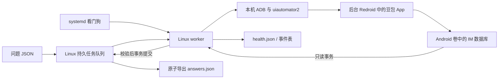

# 无人值守加固与验收记录

更新：2026-10-06。本文件是新增 Linux 本地 worker 的说明，优先于旧循环脚本的操作说明。

## 当前结论

**无人值守验收未通过，不能承诺当前环境稳定运行。**

已完成持久队列、唯一任务关联、只读事务、结果校验、失败熔断、Linux 本地运行和 systemd 看门狗配置。服务器上 22 项故障测试全部通过；已有三题通过严格消息角色和身份匹配，得到 37 条信源、15 处引用。

真实 App 验收中连续三次未获得可操作界面，队列最终为 `needs_attention=1, pending=2, completed=0`。没有自动重复提交，没有使用旧答案充当成功。ARM 转译 CHECK 错误仍存在。App 已停止，模拟器和登录卷保留，原有 8 个业务容器 ID 均未变化。

systemd 人工挂起测试得到 `Result=watchdog`，证明看门狗可以终止不再报心跳的测试进程。正式服务模板通过语法校验，**没有安装启用为生产常驻服务**。

机器可读证据：`test-results/unattended-acceptance.json`；服务器副本为 `/home/user/redroid-doubao/unattended-acceptance.json`。

## 新增模块

| 文件 | 职责 |
| --- | --- |
| `unattended_core.py` | SQLite 持久任务队列、严格消息身份匹配、正文/来源/引用校验 |
| `unattended_worker.py` | Linux 本地 ADB、UI 操作、数据库读取、任务恢复、健康状态和结果导出 |
| `test_unattended.py` | 22 项故障和正确性测试 |
| `redroid-doubao-worker.service` | systemd notify/watchdog 服务模板，尚未启用 |
| `acceptance_snapshot.py` | 收集有限实机验收、看门狗和业务容器对照证据 |
| `watchdog_smoke.py` | 故意停止心跳的独立测试进程，不处理实际任务 |

Linux 运行环境位于 `/home/user/redroid-doubao/worker-venv`；官方 Linux ADB 位于 `/home/user/redroid-doubao/linux-tools/platform-tools/adb`。依赖隔离安装，没有替换系统 Python，也没有重启 Docker 或现有服务。

## 运行架构



新 worker 不经过 Windows，也不依赖 SSH 隧道。Windows 可以关闭，前提是 Linux worker 已经作为服务启用且通过验收；当前正式服务未启用。

## 正确性规则

1. 每个批次和题号生成稳定 `task_id`。原始问题单独保存；实际发送文本附加唯一“采集任务编号”，用于 App 内消息精确关联。相同批次再次入队不会增加重复任务；改变已有批次内容会拒绝。
2. 只匹配 `user_type=1` 的请求；只选择同一会话中、该请求之后且下一条用户消息之前的 `user_type=2` 回答。不使用其他会话的旧答案。
3. 一个任务发现多个请求或多个候选回答时拒绝猜测，进入 `needs_attention`。答案重生成等情况尚未作为支持场景。
4. 所有内容块 `is_finish` 都为布尔 `true` 且正文非空，才允许成功。未知内容块、数据库 schema 变化、引用格式变化均显式失败。
5. 要求信源的任务必须有信源。来源 URL 必须为合法 HTTP(S) URL；引用 URL 同样校验，有 `doc_id` 的引用必须能关联已提取来源。
6. 结果 JSON 与任务的 ID、实际问题、请求消息 ID 必须匹配。先在 SQLite 事务中提交成功状态，再导出文件；证据截图失败不推翻已经验证的回答。

这些规则保证的是采集过程中的归属和完整性检查，不对模型输出内容进行事实审核。系统仍需底层 App 可以操作，才能持续发送下一题。

## 状态与恢复

```text
pending → prepared → completed
    ↘ 发送前恢复失败三次 → needs_attention
prepared → 发送/答案超时或数据歧义 → needs_attention
```

- `pending`：尚未承诺发送。App 恢复允许最多三次尝试。
- `prepared`：发送意图已经持久写入，随后才进行文本输入和点击发送。
- `completed`：答案已经关联和校验，结果在持久任务库中。
- `needs_attention`：当前证据不足以安全继续，整个 worker 熔断停止，退出码为 `2`。

UI 点击与远端服务接收无法做成同一个原子事务。若进程在发送边界中断，重启后只核对唯一任务编号的数据库消息，不会自动再点击发送。仍然无法确定是否发送成功时保留待处理状态。这能避免盲目重发，但也意味着不能在所有故障中保证完全无人参与的可用性。

任务库启用 WAL 与 `synchronous=FULL`；事件与状态一并保存。进程级文件锁限制一个状态目录只有一个 worker。文件输出通过临时文件、fsync、原子重命名及目录 fsync 写入。

## 操作命令

以下在 Linux 执行。当前环境只应继续有限验收，不应当成已合格的生产系统。

### 查看本次失败验收

```bash
sudo /home/user/redroid-doubao/worker-venv/bin/python \
  /home/user/redroid-doubao/unattended_worker.py \
  --state-dir /home/user/redroid-doubao/acceptance-live status
sudo cat /home/user/redroid-doubao/acceptance-live/health.json
```

保留失败验收目录，不删除或改写任务来制造绿色状态。

### 单独审计已经完成的三题

```bash
sudo /home/user/redroid-doubao/worker-venv/bin/python \
  /home/user/redroid-doubao/unattended_worker.py \
  --state-dir /home/user/redroid-doubao/acceptance-audit \
  audit-existing --questions /home/user/redroid-doubao/test_questions.json
```

该命令不发送问题，只核对已有记录。输出 `audit-existing.json`，不能把它当作新批次执行成功的证明。

### 创建新的有限验收批次

兼容性调整后，用独立的目录和批次 ID 验证：

```bash
sudo /home/user/redroid-doubao/worker-venv/bin/python \
  /home/user/redroid-doubao/unattended_worker.py \
  --state-dir /home/user/redroid-doubao/new-acceptance \
  enqueue --batch NEW_UNIQUE_BATCH \
  --questions /home/user/redroid-doubao/test_questions.json --require-sources

sudo /home/user/redroid-doubao/worker-venv/bin/python \
  /home/user/redroid-doubao/unattended_worker.py \
  --state-dir /home/user/redroid-doubao/new-acceptance \
  run --once --answer-timeout 300
```

全局参数 `--state-dir/--container/--serial/--adb` 写在子命令之前。`run --once` 在队列空时退出；队列遇到问题会熔断，而不是强行完成后面的题。

`enqueue` 只持久入队，不自动启动 worker。默认状态目录为 `/home/user/redroid-doubao/unattended-state`，当前生产队列没有被投入常驻处理。

### 导出成功任务

```bash
sudo /home/user/redroid-doubao/worker-venv/bin/python \
  /home/user/redroid-doubao/unattended_worker.py \
  --state-dir /home/user/redroid-doubao/new-acceptance export
```

只导出 `completed`，生成 `answers.json`。失败/待执行任务保留在 `tasks.sqlite` 和 `health.json` 中，不能仅看导出文件判定整批成功。

### 重跑故障测试

```bash
python3 /home/user/redroid-doubao/test_unattended.py
```

Linux 上 22 项全部通过，包括壁钟超时；Windows 会跳过 Linux 专用信号超时项。

## 看门狗与服务边界

服务模板使用 `Type=notify`，worker 主循环发送心跳；超过 120 秒无心跳，由 systemd 判定故障。UI 就绪操作另有 70 秒壁钟限制，发送操作 25 秒，证据采集 10 秒。

服务模板对异常退出有重启和次数限制；业务 `needs_attention` 退出码 `2` 配置为不自动重启，防止反复启动一个已知崩溃的 App。CPU 上限为 1 核、内存上限 512MiB，仅作用于 worker，Android 容器仍维持原来的 2 核/3GiB。

目前只提供 `health.json` 和 systemd/journal 状态，没有部署邮件、短信或聊天通知。若 worker 已退出，健康文件时间戳不会继续更新；监控应同时检查服务状态和心跳新鲜度，不能只读取文件中的字符串。

正式服务模板尚未拷贝到 `/etc/systemd/system`，未执行 `enable --now`。当前失败环境不满足启用条件。

## 上线验收门槛

建议把以下门槛作为后续验收方案，而不是本次已经完成的结果：

- 明确镜像/APK/解析器版本，冷启动和重新启动 App 不出现转译 CHECK、SIGABRT 或持续 ANR。
- 在服务器本地、Windows 关闭的条件下运行至少 24 小时，完成至少 100 个不同测试任务；结果逐题关联、完整性检查全部通过。
- 在准备、发送、等待、提交、导出等阶段强制终止 worker，恢复后不误配答案、不静默丢任务、不盲目重发。
- 验证网络断开恢复、ADB 断开、Android 容器重启、磁盘空间不足、数据库结构变化、账号失效等故障；故障状态可被监控发现。
- 记录完成率、故障恢复耗时、未解决任务数、资源峰值和原有业务服务状态。模型服务/登录状态变化导致的异常应显式失败，不伪装成成功。

目前没有执行 24 小时验收。当前 Intel 服务器上的 App 就绪测试已经失败，下一步需要解决 Android/App 转译兼容性；原生 ARM64 环境是待验证的方向，不是已证明能保证稳定的替代方案。
