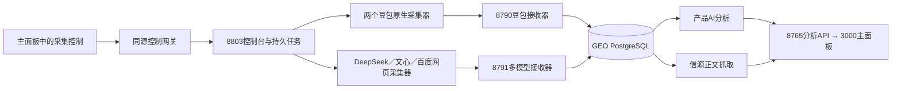

# GEO 项目统一入口

**新对话接手入口（2026-10-16 00:40）：[整个项目当前交接](CURRENT_PROJECT_HANDOFF.md)。** 包含最新11容器架构、三处阻塞、原12h/6h指针与截止、源码与证据地图、只读命令及可复制的新对话提示词。下文保留旧维护快照，当前状态优先看交接与实时指针。

**当前版本（2026-10-15晚）：** 六通道采集、GEO分析与内容创作已接入同一面板。先看[本次升级与实测说明](geo-monitor-deploy/docs/reports/UNIFIED_UPGRADE_20261015.md)及[创作源码入口](geo-monitor-deploy/creation/README.md)。[公网创作](https://1any.top/geo_monitor/#creation)直接读取GEO已有完整素材；元宝保持无头，无投屏。12小时采集／6小时创作均在复测中，尚不宣称完整时长通过。下面旧计数、登录状态及服务说明属于此前快照。

本文梳理当前生产项目。各历史文档中的计数、故障和服务状态只代表记录时刻，实时情况以面板、队列、数据库及服务进程为准。

2026-10-15代码已实际分类，本地186个文件、服务器117个工具/测试/历史脚本移入对应目录。查文件先看[GEO分类索引](geo-monitor-deploy/CODE_LAYOUT.md)及[豆包分类索引](redroid-deploy/CODE_LAYOUT.md)；生产入口保持原路径。重启和恢复证据见[本次运行维护记录](geo-monitor-deploy/maintenance/20261015-reorganize/RESTART_REPORT.md)。

## 三部分业务

| 部分 | 职责 | 生产位置 | 本地维护入口 |
|---|---|---|---|
| GEO大面板与分析 | 展示、接收采集结果、产品AI分析、信源正文抓取、数据库 | 服务器 `/opt/monitor`；Docker Compose项目 `local-server` | [GEO运维入口](geo-monitor-deploy/README.md) |
| GEO五通道采集 | 豆包1、豆包2、DeepSeek网页、文心卡片、百度卡片；任务与回传控制 | `/opt/monitor/geo-capture`；原生worker位于 `/home/user/redroid-doubao` | [控制台指南](geo-monitor-deploy/docs/guides/CONTROL_PANEL_GUIDE.md)、[豆包修复与操作](redroid-deploy/README.md) |
| 内容工作台 | 独立的采集、原文分析、写作、审稿、Word及同步 | `/home/user/geo-editorial/runtime-api` | [内容工作台指南](geo-source-card-collectors/DESKTOP_GUIDE.md)、[交接记录](PROJECT_HANDOFF.md) |

公网入口：[GEO面板](https://1any.top/geo_monitor/)、[采集控制](https://1any.top/geo_monitor/#capture/doubao1)。沿用网站登录。内网主面板 `http://192.168.31.106:3000/`，独立控制台 `http://192.168.31.106:8803/`。

GEO核心由8个Docker容器运行，两个豆包Android容器另外常驻，共10个运行容器；采集器、控制台、内容工作台和隧道等另由systemd管理。容器数不等于业务数。GEO统一target是管理入口，核心容器仍由原Compose负责，内容工作台仍保持独立。

## 数据怎么流转

`processed`表示采集数据已接收并入库；产品分析完成另看`ai_verified`，信源正文抓取有独立状态。百度与文心目前都归入`wenxin`模型，原始批次、capture_mode及设备标签仍区分两类采集。百度相同问题的完全相同结果去重，原始轮次观测保留。

## 本地目录用途

| 目录 | 用途与处理原则 |
|---|---|
| `geo-monitor-deploy/` | GEO控制台、最新主面板接入代码、部署工具、验收及维护记录 |
| `geo-monitor-deploy/tools/`、`redroid-deploy/tools/` | 分类后的部署、诊断、导出工具；`archive/one_off/`另放历史一次性修改脚本 |
| `geo-monitor-deploy/tests/`、`redroid-deploy/tests/` | 回归测试；原生worker的完整运行测试在Linux执行 |
| `geo-monitor-deploy/docs/`、`redroid-deploy/docs/` | 操作指南与历史报告；GEO结构化证据在`reports/20261015/`，发布包在`releases/` |
| `redroid-deploy/` | 两个原生豆包的采集器、修复工具、操作脚本、测试和历史证据；`remote.py`是现有SSH入口 |
| `geo-source-card-collectors/` | 网页采集和内容工作台源码及测试；生产各自使用独立venv与运行目录 |
| `deliverables/ContentWorkspace/` | 已打包桌面程序及必需运行库，不能当构建缓存删除 |
| `outputs/api-editorial/articles/` | 同步的Word成品及证据，保留 |
| `outputs/**/diagnostics/`、`redroid-deploy/test-results/` | 诊断、失败现场和验收，不按“旧文件”直接删除 |
| `outputs/**/intermediates/` | 历史构建与迁移材料；本次只清理其中可再生构建子目录，其余资料保留 |
| `redroid-deploy/artifacts/` | ADB、scrcpy、当前APK、Houdini包及现场证据；旧NDK下载缓存已清理，详见目录说明 |
| `redroid/`、`Scrapling/` | 上游源码仓库，保留`.git`和本地修改 |
| `doubao-headless-technical-docs/` | 独立技术文档仓库，含历史代码快照，不能当作当前生产版本部署 |
| `ecommerce-review-exporter/`及其zip | 另一个独立工具，本次保留 |
| `references/wenxin-baidu-collector/` | 用户指定的只读参考仓库，固定commit及比对记录见[参考说明](references/README.md)；不直接启动其supervisor |
| `yuanbao-deploy/` | 新增独立元宝Android与投屏、原生存储适配；当前登录及采集验收进度见[元宝说明](yuanbao-deploy/README.md) |

主GEO完整后端的生产源码在服务器`/opt/monitor`，本地工作区不是它的完整镜像。前端本轮修改源码在`geo-monitor-deploy/dashboard-integration/app/`；该目录名字虽含integration，但已包含公网前缀适配，旧发布zip不能覆盖它。

## 当前结果与后续问题

- [双豆包两小时报告](geo-monitor-deploy/docs/reports/DOUBAO_2H_REPORT_20261015.md)：116/119条全部processed及保真通过，两批次已暂停，两个模拟器仍运行；原105/105未重跑。
- [最新分析复查](geo-monitor-deploy/docs/reports/ANALYSIS_PROGRESS_20261015_1317.md)：13:17快照370/374条产品分析完成，部分信源正文仍缺失；这是快照，不代表此后不再变化。
- DeepSeek网页采集等待登录，与DeepSeek付费API是否有余额是两回事。
- 百度桥接的退出／队列快照竞态已修复，原批次恢复；14:17新增5条完整processed结果，未取得完整卡片的观测单独保留，详见[重启与恢复记录](geo-monitor-deploy/maintenance/20261015-reorganize/RESTART_REPORT.md)。
- [2026-10-15清理与项目整理报告](geo-monitor-deploy/maintenance/20261015/CLEANUP_REPORT.md)：清理范围、实际空间、恢复方式、前后服务核验及逐文件清单。

配置、API key、SSH密钥、浏览器登录资料仅由原程序读取，不复制到公开文档。任何清理都不能触及生产数据库、Android数据卷、批次队列、outbox、receipts、登录profile和唯一失败证据。
